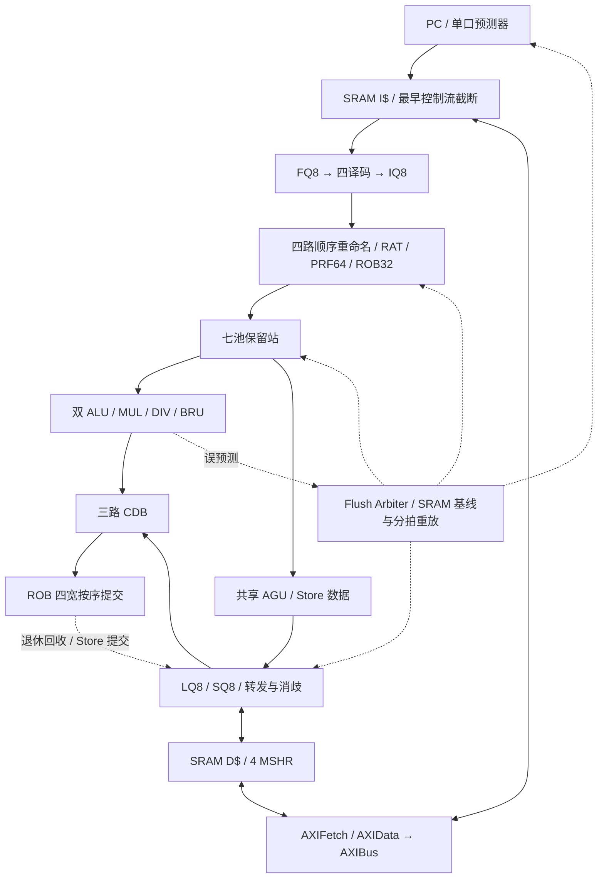

# RISC-V CPU 2026

SystemVerilog **RV32IM 乱序处理器**：顺序重命名/分配、七池保留站、乱序执行、按序提交，SRAM I$/D$ 经共享 AXI4-Lite 访问外存。

## 当前实现（2026-10-29）

默认四取指、四译码、四路分配、四提交，双 ALU 各占一路 CDB，Load/MUL/DIV 共享第三路；AGU 和数据访存请求仍为单口。

| 项目 | 默认配置 |
|---|---|
| FQ / IQ / ROB / PRF | 8 / 8 / 32 / 64 项 |
| 七池 RS | Integer4、Multiply1、Divide1、Branch4、Load2、StoreAddr2、StoreValue2 |
| LQ / SQ / Load 运输 owner | 各 8 项 |
| 预测 | Tournament：LHT256×1、local256×3、global/chooser 各256×2；GHR8、寄存器 BTB32、RAS8、checkpoint64 |
| I$ | 1 KiB / 64 B 行，直接映射；2 个请求包，最多 8 个指令字信用 |
| D$ | 8 KiB / 32 B 行，128 组×2 路；8 请求、4 MSHR |

生产默认入口的六项 `perf_*` 已通过，几何 IPC 为 **0.858427672694**；**本配置尚无有效最终面积/Fmax，未通过完整 PPA 资格**。该 IPC 按课程外部退出完成周期计算，不与历史 core 周期 IPC 混用。验证范围见 [course.md](docs/course.md)。



程序以向 `0x80000000` 全字写结果退出：Store 退休冻结核心，对应 B 握手结束仿真，不扫描全部 dirty 行。当前支持合法 RV32IM、对齐控制转移的无异常输入域，不实现 CSR/系统异常处理。

## 使用

宿主需要 Python 3.10+、GNU Make、G++（C++17）及 binutils；Linux x86-64 / WSL2 使用课程 AppImage，综合另需 `sv2v`。

```bash
git submodule update --init --recursive
chmod +x cpu2026-tools-x86_64.AppImage
make build JOBS=4
make test MAX_CYCLES=100000000
make perf MAX_CYCLES=100000000
```

普通构建无需额外宽度宏。配置、单例、波形和 OJ 提交见 [template.md](docs/template.md)，综合方法见 [assessment.md](docs/assessment.md)。`SIM=` 会跳过编译，旧二进制不代表新配置；`make clean` 会删除构建目录及其中历史报告。

## 文档与目录

- [架构探索过程](docs/process.md) · [当前架构与配置](docs/architecture.md)
- [课程使用与评分](docs/template.md) · [原始计划](docs/plan.md)
- [AXI协议](docs/axi4-lite.md) · [SRAM模型](docs/sram.md)
- [验证范围](docs/course.md) · [综合评估](docs/assessment.md)

RTL 位于 `verilog/rtl/`，活动清单为 `verilog/filelist.f`；`scripts/` 提供构建/验证/综合工具，`testcases/` 为课程子模块，`packaging/` 用于重建工具包。软件对拍所需的同级 `RV32IM_Simulator/`、`sync/` 及未跟踪的 `build/` 工件不随本仓库克隆提供。
