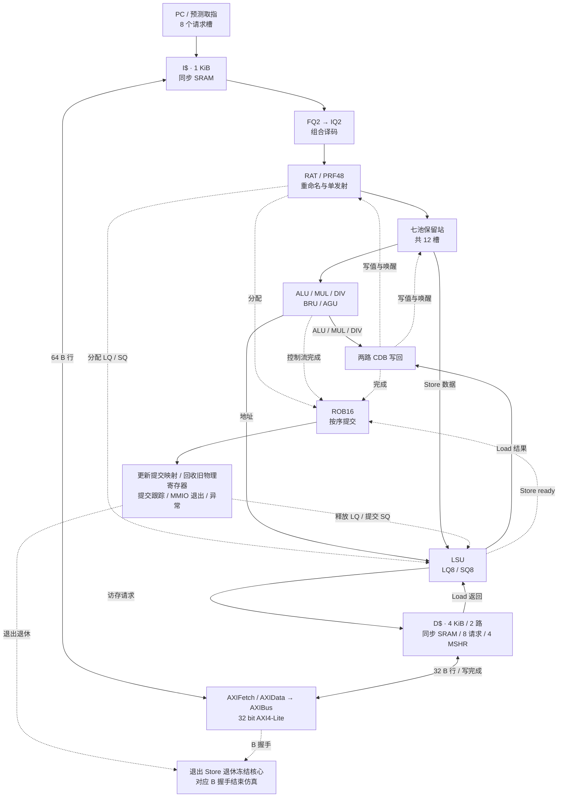
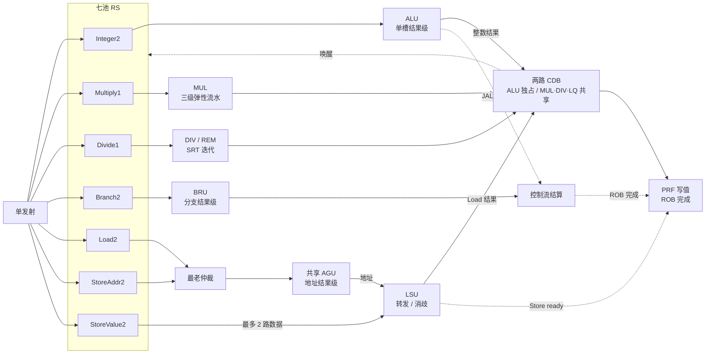
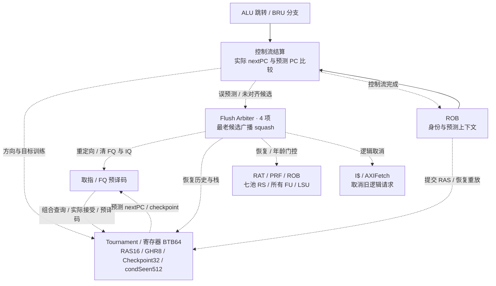

# RISC-V CPU 2026

SystemVerilog **RV32IM 乱序处理器**：单宽取指/发射/提交、七池保留站、乱序执行、两路写回、按序提交。


[`student_top.sv`](verilog/rtl/student_top.sv) 已连接实际 core、SRAM I$/D$ 与共享 AXI4-Lite 主机。
活动预测器使用寄存器 BTB；两种 SRAM BTB 仅保留独立实验模块与单元测试，不进入课程 filelist。
程序向 `0x80000000` 全字写结果：Store 退休冻结核心，对应 B 握手结束仿真，不扫描全部 dirty 行。
验收范围与未完成项见[课程说明](docs/course.md)；历史 PPA/IPC 不能套用当前顶层。

| 项目 | 配置 |
|---|---|
| 指令集 / 数据位宽 | RV32IM / 32 bit |
| 取指、发射、提交宽度 | 各 1 条/拍 |
| FQ / IQ / ROB / PRF | 2 / 2 / 16 / 48 项 |
| 七池 RS | Integer2、Multiply1、Divide1、Branch2、Load2、StoreAddr2、StoreValue2 |
| LQ / SQ / Load 运输 owner | 各 8 项 |
| 方向预测 | local/global PHT + chooser，各 256×2 bit；GHR8、condSeen512 |
| BTB / RAS / Checkpoint | 64 / 16 / 32 项 |
| I$ | 1 KiB / 64 B 行，直接映射，8 请求槽 |
| D$ | 4 KiB / 32 B 行，64 组×2 路，4 MSHR、8 请求槽 |
| 时钟与复位 | 上升沿更新；顶层高有效复位，内部低有效异步复位；`RESET_PC=0` |

## 流水线架构

图按功能分组；实线为数据/请求，虚线为控制/状态更新。可将 Mermaid 源码复制到 [Mermaid Live Editor](https://mermaid.live/) 放大。

### 流水线总览



I$/D$ 位于 `rv32_core` 外；`rv32_dmem_backend` 包含 D$ 与 MMIO 旁路，不含全 dirty 排空控制。

### 执行与写回



PRF 在 core 中使用 3 读/2 写口与 FIFO 空闲队列。MUL 为 Booth → CSA → 最终加法。
CDB 同拍写值并捕获唤醒，下拍才派发依赖项；BRU、Store ready 不占 CDB，JAL/JALR 链接值在分配时预置。
LSU 单源完整覆盖转发，最多 8 个独立运输 owner 按 ID 认领乱序返回；Load 在退休释放 LQ，Store 在内存接受后释放 SQ。

### 预测与恢复



恢复采用已提交 RAT/RAS 同步 SRAM 基线读 1 拍＋ROB 重放 4 拍，每拍最多处理 4 条，RAT/RAS/free list 共用恢复指针；恢复窗口暂停发射和退休，访存返回继续排空。布局与时序见 [backend.md](docs/backend.md)。已提交 Store 保留，错路 Load 返回排空；总线适配器丢弃旧物理取指事务的迟到响应。

## 使用与目录

宿主需要 Python 3.10+、GNU Make、G++（C++17）与 binutils。工具配置和完整命令见[课程模板](docs/template.md)，本工程补充见[使用与验证](docs/course.md)。

```bash
git submodule update --init --recursive
chmod +x cpu2026-tools-x86_64.AppImage
make help
make build JOBS=4
make test MAX_CYCLES=100000000
make perf MAX_CYCLES=100000000
make synth MODE=opt CLOCK_PERIOD_NS=2.0
```

`make` 默认构建并生成 OJ 入口 `./code`；`Case=用例名` 指定单例，`make run` 可用 `WAVE` / `LOG` 输出波形和日志。

| 路径 | 用途 |
|---|---|
| `verilog/rtl/` | common、frontend、predictor、backend、execute、memory、core 与课程顶层 |
| `verilog/filelist.f` | 活动 RTL 清单，路径相对于 `verilog/` |
| `verilog/assessment/` | 无外部从机的面积/时序评估及独立 BTB 顶层 |
| `scripts/` | 仿真、测试、综合与报告工具；`tests/` 为单元/转换回归 |
| `testcases/` | 官方正确性与性能用例，Git 子模块 |
| `packaging/` | 重建工具链 AppImage，普通构建无需运行 |
| `build/` | 已忽略的生成文件与历史报告；`make clean` 会一并删除，请先备份重要结果 |

软件对拍还需要同级 `RV32IM_Simulator/`，不是独立克隆仓库的必备依赖。

## 文档

完整分类见 [文档索引](docs/README.md)。[课程模板](docs/template.md)与[实现计划](docs/plan.md)保留原文；当前实现以专题文档及对应源码为准。
