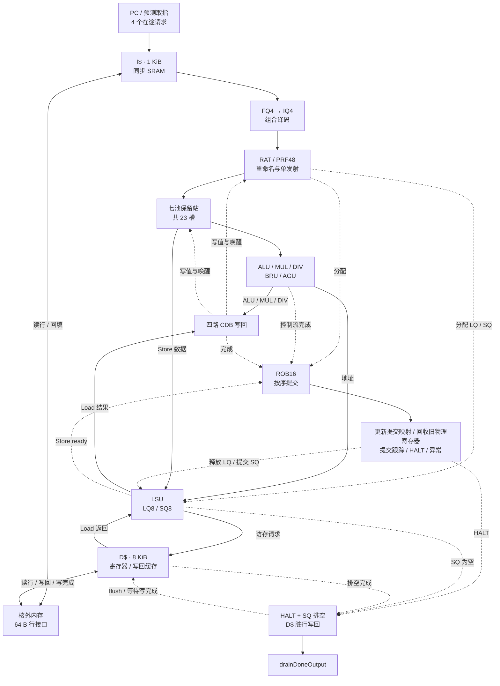
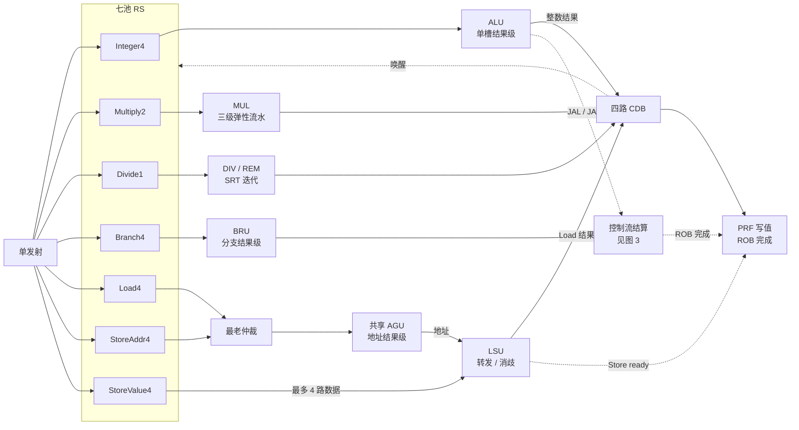
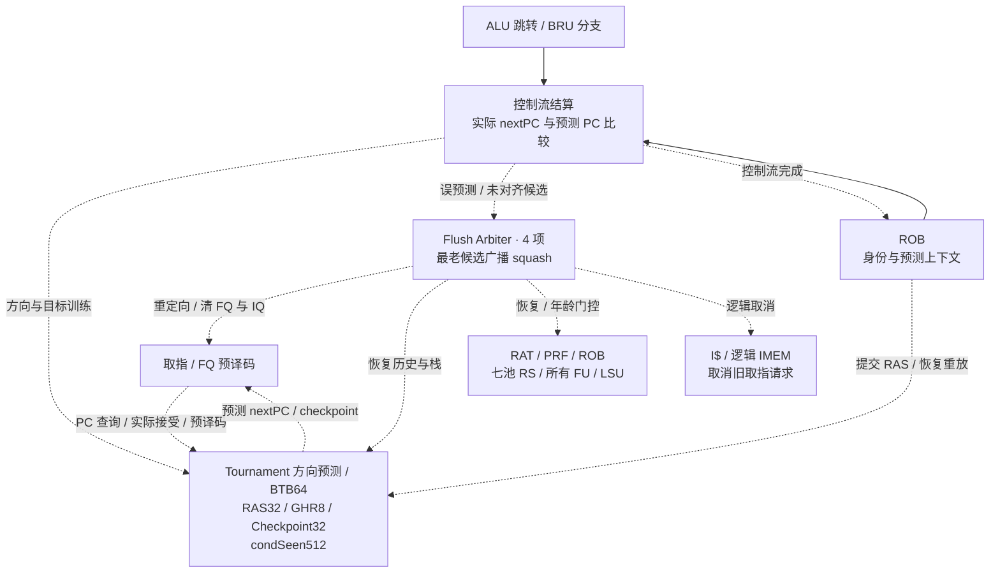

# RISC-V CPU 2026

基于 SystemVerilog 的 **RV32IM 乱序处理器**：单宽取指与发射、七池保留站、乱序执行、四路并行写回、按序提交。核心入口为 [`rv32_core`](verilog/rtl/core/rv32_core.sv)，I$/D$ 为独立核外模块。

## CPU 流水线架构

架构分为总览、执行数据通路和预测恢复三张图。图按功能分组，队列与执行单元形成实际时序边界；实线表示数据或请求，虚线表示控制与状态更新。

放大查看：将单张图的 Mermaid 源码复制到 [Mermaid Live Editor](https://mermaid.live/)，导出 SVG 后单独打开，可无损缩放。

### 1. 流水线总览



I$/D$ 位于 `rv32_core` 外；`rv32_dmem_backend` 包含 D$ 与最终排空控制。

### 2. 执行与写回



PRF 使用 3 读/4 写口和 FIFO 空闲队列。MUL 为 Booth → CSA → 最终加法；LSU 采用单源完整覆盖转发，仅允许一个在途 Load。

### 3. 预测与恢复



恢复重放来自存活 ROB 窗口；已提交 Store 保留，错路 Load 返回排空。物理总线适配器负责丢弃已取消事务的迟到响应。

- **发射与派发**：每拍分配一条指令；各 RS 独立寻找就绪项，Load/StoreAddr 竞争一个 AGU，StoreValue 可并行交付四项。
- **写回**：CDB 同拍写 PRF、通知 ROB 并捕获唤醒，下拍才可派发依赖项。BRU 和 Store ready 不占 CDB；JAL/JALR 的链接值在分配时预置为 PC+4。
- **退休与恢复**：Load 提交时释放 LQ；Store 提交后仍留在 SQ，内存接受才释放。恢复以完整 ROB tag 为边界，执行单元按各自年龄规则过滤结果。
- **停机**：core 的 `haltedOutput` 只表示 HALT 与 SQ 接受排空；接缓存时，以 `drainDoneOutput` 确认全部脏行写回完成。

## 默认配置

| 项目 | 配置 |
|---|---|
| 指令集 / 数据位宽 | RV32IM / 32 bit |
| 取指、发射、提交宽度 | 各 1 条/拍 |
| FQ / IQ / ROB / PRF | 4 / 4 / 16 / 48 项 |
| LQ / SQ | 各 8 项 |
| 方向预测 | local/global PHT + chooser，各 256×2 bit；GHR 8 bit |
| BTB / RAS / Checkpoint | 64 / 32 / 32 项 |
| I$ / D$ / Cache Line | 1 KiB / 8 KiB / 64 B，默认直接映射 |
| 核心时钟与复位 | 上升沿更新、低有效异步复位；`RESET_PC=0` |

## 目录

```text
verilog/rtl/
├── common/      公共类型、FIFO、CLA、SRAM
├── frontend/    取指队列与译码
├── predictor/   方向预测、BTB、RAS、检查点
├── backend/     RAT、PRF、ROB、保留站
├── execute/     ALU、MUL、DIV、BRU、AGU
├── memory/      LSU、I$、D$、最终排空
└── core/        核心集成与恢复仲裁
scripts/         Verilator 仿真、Yosys/ABC 综合、OpenSTA 分析
testcases/       官方正确性与性能用例（Git 子模块）
docs/            模块接口与课程协议文档
```

RTL 清单为 [`verilog/filelist.f`](verilog/filelist.f)，路径相对于 `verilog/`。工具路径与运行参数由 [`config.mk`](config.mk) 配置。

## 使用

宿主环境需要 Python 3.10+、GNU Make、G++（C++17）和 binutils。Linux x86-64 / WSL2 可使用根目录的课程工具链 AppImage。

```bash
git submodule update --init --recursive
chmod +x cpu2026-tools-x86_64.AppImage
make help
```

**当前集成状态**：[`student_top.sv`](verilog/rtl/student_top.sv) 仅有接口声明，尚待完成核心/缓存连接、AXI4-Lite 适配、高有效复位转换及 MMIO 退出。课程程序通过向 `0x80000000` 全字 Store 并收到写响应结束；原生 core 使用 `HALT_INSN=0x0ff00513`。

课程封装完成后，在仓库根目录运行：

```bash
make build JOBS=4                         # 生成 build/sim
make test                                # 正确性测试
make perf                                # 周期与 IPC
make synth MODE=opt CLOCK_PERIOD_NS=2.0   # 面积与时序，输出 build/synth/opt/
```

### 本机核心 + I$/D$ 层次面积诊断（2026-10-11）

评估范围为原生核心、1 KiB ICache、8 KiB 寄存器 DCache 及最终排空控制，采用
Yosys/ASAP7 + OpenSTA 的 `diagnose` 模式（保留模块层次）。

- **总面积：71,458.562 μm²**（组合逻辑 42,504.709 μm²、时序逻辑 28,609.867 μm²、SRAM 343.985 μm²）。
- **估计最高频率：25.21 MHz**，最小时钟周期 **39.6641 ns**。
- 目标时钟周期：2.000 ns；最差 setup slack：−37.6635 ns。

下表按功能模块分组，实例路径相对于 `student_top`。**含子模块面积**用于查看模块整体开销，
**直接面积**只计该实例自身，内部加法器等细节已包含在对应模块中。父子行的含子模块面积
存在重叠，不能整列相加；占比统一以总面积 71,458.562 μm² 为分母。

| 分类 | 模块 | 实例路径 | 含子模块面积（μm²） | 占总面积 | 直接面积（μm²） |
|---|---|---|---:|---:|---:|
| 总体 | **CPU + 缓存总计** | `student_top` | **71,458.562** | **100.00%** | 0.306 |
| 缓存 | 数据缓存及排空控制 | `u_dmem_backend` | 45,757.522 | 64.03% | 2.435 |
| 缓存 | ↳ DCache | `u_dmem_backend/cache` | 45,755.087 | 64.03% | 45,749.022 |
| 缓存 | ICache（含数据 SRAM） | `u_icache` | 1,142.211 | 1.60% | 796.549 |
| 缓存 | ↳ 数据阵列及宏接口 | `u_icache/u_data` | 345.662 | 0.48% | 345.662 |
| 核心 | **核心小计** | `u_core` | **24,558.523** | **34.37%** | 73.017 |
| 预测器 | BPU 小计 | `u_core/u_predictor` | 8,187.807 | 11.46% | 16.534 |
| 预测器 | ↳ RAS 返回地址栈 | `u_core/u_predictor/u_ras` | 3,454.323 | 4.83% | 3,454.323 |
| 预测器 | ↳ BTB 分支目标缓冲 | `u_core/u_predictor/u_btb` | 3,067.078 | 4.29% | 3,067.078 |
| 预测器 | ↳ 方向预测 | `u_core/u_predictor/u_direction` | 1,463.701 | 2.05% | 1,463.701 |
| 预测器 | ↳ Checkpoint 检查点 | `u_core/u_predictor/u_checkpoint` | 186.172 | 0.26% | 186.172 |
| 前端 | 前端小计 | `u_core/u_frontend` | 661.276 | 0.93% | 251.082 |
| 前端 | ↳ FQ 取指队列 | `u_core/u_frontend/u_fq` | 205.097 | 0.29% | 205.097 |
| 前端 | ↳ IQ 指令队列 | `u_core/u_frontend/u_iq` | 205.097 | 0.29% | 205.097 |
| 前端 | Decoder 译码器 | `u_core/u_decoder` | 13.253 | 0.02% | 13.253 |
| 重命名与提交 | RAT 重命名映射表 | `u_core/u_rat` | 777.201 | 1.09% | 777.201 |
| 重命名与提交 | PRF 物理寄存器堆 | `u_core/u_prf` | 2,748.345 | 3.85% | 2,748.345 |
| 重命名与提交 | ROB 重排序缓冲 | `u_core/u_rob` | 2,724.594 | 3.81% | 2,686.321 |
| 访存 | LSU（含 LQ/SQ） | `u_core/u_lsu` | 3,336.939 | 4.67% | 3,336.939 |
| 保留站 | Integer RS | `u_core/u_int_rs` | 683.831 | 0.96% | 683.831 |
| 保留站 | Multiply RS | `u_core/u_mul_rs` | 371.615 | 0.52% | 371.615 |
| 保留站 | Divide RS | `u_core/u_div_rs` | 204.207 | 0.29% | 204.207 |
| 保留站 | Branch RS | `u_core/u_branch_rs` | 688.468 | 0.96% | 688.468 |
| 保留站 | Load RS | `u_core/u_load_rs` | 694.198 | 0.97% | 694.198 |
| 保留站 | StoreAddr RS | `u_core/u_store_addr_rs` | 694.198 | 0.97% | 694.198 |
| 保留站 | StoreValue RS | `u_core/u_store_value_rs` | 838.671 | 1.17% | 838.671 |
| 执行单元 | ALU 单元（含结果级） | `u_core/u_alu_unit` | 173.269 | 0.24% | 34.482 |
| 执行单元 | ↳ ALU 运算逻辑 | `u_core/u_alu_unit/u_alu` | 138.787 | 0.19% | 74.664 |
| 执行单元 | MUL 乘法单元 | `u_core/u_mul_unit` | 741.189 | 1.04% | 699.257 |
| 执行单元 | DIV 除法/取余单元 | `u_core/u_div_unit` | 461.734 | 0.65% | 417.003 |
| 执行单元 | BRU 分支单元 | `u_core/u_bru_unit` | 196.232 | 0.27% | 98.984 |
| 执行单元 | AGU 地址生成单元 | `u_core/u_agu_unit` | 48.376 | 0.07% | 27.454 |
| 控制与辅助 | Flush Arbiter 恢复仲裁 | `u_core/u_flush_arbiter` | 219.225 | 0.31% | 219.225 |
| 控制与辅助 | 跳转链接地址加法器 | `u_core/u_link_add` | 20.879 | 0.03% | 0.000 |

面积热点为 DCache（64.03%）和预测器（11.46%）。最差路径为
`u_core/u_flush_arbiter/_4036_/QN → u_dmem_backend/cache/_701283_/D`。