# 整核时序分析

文中「当前生产」指本仓库默认综合源码对应的[已测快照](README.md)。频率为理想时钟、无互连寄生的 STA 估计。

## 当前生产

**D$ 2×64 读掩码分组采样：484.619025 MHz／31451.94 μm²／原六几何 IPC 1.104520180**。保留 LQ4/SQ4、AXI 写队首地址侧带、I$ 宏 WE 分离。同口径 2.0 ns 下 **27498** 个计时端点、**25** 个 setup 违例，WNS **−63.267 ps**、TNS **−0.418963 ns**；相对前生产／W8／S 频率 **+0.189%／+21.451%／+14.766%**，违例 **107→25**。完整覆盖、227 宏一致。按授权采用，未达 490 MHz。收据 `.cpu2026-synthesis/dcache-banked-mask-production-20261123-r01/adoption.json`。

**当前限频：** ROB `head[0]` → D$ `readWayMaskLowInner[0]`。490 MHz 下余 **3** 个缺口，均为分组有效位寄存器，路径共用前 **35** 级，最差仍欠 **22.451 ps**；高位选择 FF 不限频。固定网表折算 **480／490／495／500 MHz** 分别欠 **0／3／5／25** 点。后续 setup 非退化基线为 **25**；未开新实验。

**25 个端点逐位核对（2.0 ns，每点只计一次）：** D$ 四个分组有效位的最差路径均从 ROB `head[0]` 出发，`Low[0]／High[1]／High[0]／Low[1]` 余量 **−63.267／−53.882／−48.417／−33.146 ps**。另 **21** 点均从 ROB `head[2]` 到 PRF `freeListInner[槽][位]`，槽／位为 **15:{1,3,5}、20:{0,1,2,3,5}、21:{2}、22:{1,4,5}、25:{0,1,3,4,5}、28:{0,2,4,5}**，余量 **−27.214～−0.445 ps**；两组 TNS 分别 **−198.712／−220.251 ps**。固定网表折算 490 MHz，PRF 全部通过（最差余 **13.602 ps**），只余前三个 D$ 点。按生产 SHA 复用 `.cpu2026-synthesis/production483-dcache-banked-mask-20261123-r02/candidate/endpoints-candidate/all-timed-endpoints.tsv` 及生产 `review.py` 核对身份。

### 484 MHz 关键路径与裸槽号试验

当前网表独立 CEC 核实的主干如下，累计到达来自原 STA；级号仅属于当前映射。

| 级段 | 功能锚点 | 累计到达 |
|---|---|---:|
| G1–6 | ROB 退休读口，G6 为退休通道 2 的 SQ 槽号 bit 0 | 390.1 ps |
| G7–16 | SQ 槽匹配、退休资格，G16 为 `postedStoreMaskInner[1]` | 796.8 ps |
| G17–22 | posted Store 阻挡 Load／端口仲裁，G21–22 为 `!storeSendSelectedInner` | 949.7 ps |
| G23–28 | Store 请求／就绪、槽 4 预取取消；G28 为 `!(|demandLookupMaskInner) && !cpuRequestInput.valid` | 1210.4 ps |
| G29–34 | 候选与年龄筛选；G34 为 `lookupCandidateInner[2:0] != 7`，等价“槽 0–6 有年龄合格项且槽 7 不合格” | 1558.4 ps |
| G35 | `_352010_/Y`：原读端口开放条件 AND G34，等价 `lookupInner[2:0] != 7` | **1602.3 ps** |

**分叉后的晚输入确是低位选表。** G35 负载 **3.063 fF／7 个逻辑脚**。三路 G37 分别为 `!set[1]／!set[2]／!set[5]`；随后分别译码低六位值 **0／25／62**，再与该 bank 的有效位合并：

| 终点 | G37 到达 | 首次并入有效位 | G35→D |
|---|---:|---:|---:|
| Low[0] | 1717.3 ps | G41 | 401.7 ps |
| High[1] | 1684.8 ps（G38 缓冲后 1749.8） | G42 | 392.1 ps |
| High[0] | 1693.8 ps | G41 | 401.4 ps |

有效位数据、CPU 直读及保持条件随后汇合；上述路径不经过 SRAM 内部时序弧。只按 `set[5]` 再分为 4×32，不能据此认定覆盖三处缺口。每门函数、侧输入、负载和转沿见 `.cpu2026-synthesis/production484-dcache-cut-review-20261123-r04/annotated-paths.json`；当前身份及组合证明见同前缀 `r03/identities.json`、`r04/semantic-close.json`。

**试验切点：低六位取表专用的裸三位请求槽号。** 在 `rv32_dcache.sv` 的 `lookup_index` 编码与 `g_read_mask_banks` 旧请求取表之间，直接用现有 `lookupWinnerInner` 的三位 OR 编码（无赢家时为 0）供取表；将“无候选置 −1”和最终读授权从该数据索引中分离。原 `lookupInner>=0`、CPU 优先、无读保持、旧表采样及 `set[6]` 捕获仍承担原职责，结构不增状态。已在当前 pre-ABC／mapped 边界证明：实际旧请求读授权下，**3 位槽号、7 位 set、4 个分组有效位共 14 项等价**。这只支持功能切分，不能把 G34/G35 延时直接扣除，也未证明上游候选逻辑消失。

**历史查重与取舍。** 现存 **94** 份源快照、**14** 种内容和 **13** 个相关 Git 修订未见相同取表实现。它仍属早索引家族：历史版改用 `lookupCandidateInner`，保留了无赢家时的 −1，实测 **387.585163 MHz**，掩码仅改善约 **14 ps**；不能将本变体称为已证提频。prefetch-last **475.615420 MHz**、3+4 **471.454880 MHz**、实时镜像 **481.882353 MHz** 的改动与测量已对照；后二者分别使每赢家新增 24／2 项，仍拖慢整核，故优先局部索引分离，避免直接放大预译码或状态更新网络。旧早索引原基线网表已缺失，保留证书边界。查重证据同目录 `history-review.json`。

**2.0 ns 整核实测（未采用）：471.889401 MHz／31683.34 μm²／IPC 1.104520180**。相对生产／W8／S **−2.627%／+18.260%／+11.751%**；setup 违例 **25→649**、490 MHz 缺口 **3→409**。`Low[0]` 余量 **−63.267→−52.790 ps**，仍未到 490 MHz；未改 RTL 选路的 `set[6]` 捕获位也从 **+152.488→−29.316 ps**。最差迁到 ROB `head[2]`→D$ SRAM `addr_in[4]`，同一捕获脚最差余量 **+90.157→−118.324 ps**（起点不同）；D$ 地址组新增 **458** 个违例，共用前 **16** 级，其余为 PRF **76**、IQ **100**、D$ 使能 **10**、掩码 **5**。独立对照 524288 项通过，真实 D$ 覆盖全部 8 个槽、两个故障反例检出；原六 **374104 条九字段退休逐周期／lane 一致**。已按 pre-ABC 连线核实一对 AXI 有效位异名：两版 **27498** 个计时端点完整、**21626** 个 FF 和 **227** 个宏逐实例对应，无未审告警。证据 `.cpu2026-synthesis/production484-dcache-raw-index-20261123-r04/{result,coverage-audit,axi-alias-proof}.json` 及 `r03/focus-diagnostics.json`；复用已有网表和 STA，不叠加、不自动试下一项。

### 下一步只读筛选

**首选 LSU 同拍退休 Store 冲突判断。** 对同一组掩码 FF 限定经过脚，固定网表折算 490 MHz，经过 LSU `postedStoreMaskInner[1]` 的最差路径欠 **22.451 ps**；同一起点经过 `storeAvailableInner` 的支路余 **62.005 ps**；经过 D$ G35 读端口开放输入的支路余 **450.953 ps**。

只改让行冲突的合并顺序：先算选中 Load 与各 SQ 槽的冲突，旧已提交槽照常参与；同拍退休的通道按各自槽号取冲突位，最后由原实际退休授权放行。保留地址比较、Store 优先级与让行债务，不同于历史按 LQ 行预计算但仍使用完整 posted 掩码的改法。抽象 **1048576** 组等价，原六生产轨迹 **361327 拍**核对一致。未测整核提频，需检查 Load 选槽及退休槽号负载。

**参数备选：Store 命中位置表 4→3。** 同一生产轨迹的三项影子表漏掉 **1953／30146** 次快速写授权（towers 306、qsort 252、rsort 1395），并不等于增加的周期；IPC 降幅只容许约 **0.409%**，暂列备选。证据 `.cpu2026-synthesis/production484-other-cuts-20261123-r02/result.json` 及同前缀 `r01/{result,hazard-algebra}.json`。两项均未建候选或综合。

## 前生产 483.703354 MHz 与同基线试验

LQ4/SQ4 + AXI 写队首地址侧带 + I$ 宏 WE 分离：**483.703354 MHz／31622.01 μm²／原六几何 IPC 1.104520180**。2.0 ns 下 **27495** 个计时端点、**107** 个 setup 违例，WNS **−66.502 ps**、TNS **−1.537139 ns**；相对前生产／W8／S 频率 **+0.850%／+21.221%／+14.549%**。完整覆盖、227 宏一致。未达 490 MHz，违例 **58→107**，按用户明确授权例外采用。收据 `.cpu2026-synthesis/icache-we-mode-production-20261123-r01/adoption.json`。

### 483.703354 MHz 前生产：关键路径示意图

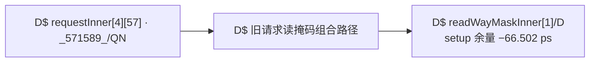

**I$ 宏 WE 分离。** 保持 CE、地址与握手，仅改宏 `WE=refillFound && !(freeze && readValid) && wayMatch`。128 项端口模式、真实模块及两个故障反例通过。`NOR2xp33` 只带 **16** 个宏 WE，零逻辑脚，宏脚最差余 **175.179 ps**；宏 WE 与 `consumeInner` 均不在各违例端点的所选最差路径上。违例变化：D$ CE **26→0**、PRF 空闲表 **30→105**、D$ 掩码仍 **2**。固定网表折算 **480／490／495／500 MHz** 分别欠 **0／7／30／107** 点；490 MHz 下两路 D$ 掩码差 **25.686／22.398 ps**，五个 PRF 位差 **2.198–8.363 ps**。证据 `.cpu2026-synthesis/production479-icache-we-mode-20261123-r02/{result,coverage-audit,we-topology}.json`。

**483 MHz 前生产，两路 D$ 掩码切点复核。** 旧请求槽 4 的地址 bit 8（set bit 3）到两个掩码 **46／47** 级，共用前 **41** 级，约 **1870 ps**，分叉后约 **150／154 ps**。只翻此地址位，两边都实际读同一槽时，两个掩码分别仍可改变，但 G41 不变；G41 也不等于任何 SRAM set 位或其反相。故不把共用 41 级当作已敏化的连续地址通路，不删时序弧。证据 `.cpu2026-synthesis/production483-dcache-mask-review-20261123-r01/result.json`。

**旧请求掩码早索引。** 实际授权时，早候选槽号与原取表的组号及两路掩码相同。483 MHz 两条最差路径均经 G34（候选槽号位，**1535 ps**）→G36（晚授权后的槽 6 选择，**1628 ps**）→G38（取表组号 bit 6，**1718 ps**），晚资格仍在取表逻辑内。完全相同的一行改动曾在 482.563619 MHz 前生产独立实测：掩码仅改善 **14.441／13.608 ps**，整核降至 **387.585163 MHz**，违例 **842→2805**，未采用；当时限频为尚未分离的 I$ WE 重载，不能外推到现生产。见[旧实测与限频复核](#490-mhz-横比与接续)及 `.cpu2026-synthesis/production483-dcache-early-index-review-20261123-r0{1,2}/result.json`。

**3+4 在 483 MHz 生产上复试（未采用）。** 两路掩码 2.0 ns 余量 **−63.214／−66.502→+52.780／+51.248 ps**；I$ WE 仍只接 **16** 个宏脚，`consumeInner` 不在违例端点的所选最差路径中。整核 **471.454880 MHz／31700.51 μm²／IPC 1.104520180**，相对生产／W8／S **−2.532%／+18.151%／+11.648%**；2.0 ns 违例 **107→949**（D$ SRAM 地址 **290**、前端 IQ **659**，PRF 空闲表 **105→0**），490 MHz 欠 **208** 个 D$ 地址脚及 **70** 个 IQ 位。最差 ROB `head[0]`→D$ `addr_in[6]` **−120.752 ps**。原六完整退休一致、27495 端点完整、227 宏一致，无新增告警。证据 `.cpu2026-synthesis/production483-dcache-mask34-20261123-r01/{result,coverage-audit,focus-diagnostics,we-topology}.json`。不自动重试；可先查 D$ 地址与掩码的共用选择逻辑及 IQ 退化再选切点。

**3+4 地址退化定点复核（只读）。** 地址和掩码共用候选资格、年龄仲裁及 `lookupWinnerInner`；地址仍独立选 7 位 set，再按各 bank 的读／回填／Store 选路。pre-ABC 每个赢家位直连 **8–18→32–42** 个逻辑输入，精确新增 **24** 个 AND 输入；`lookupAddressInner` 每位直连数仍为 **24**。同一 SRAM `addr_in[6]` 的最差余量 **+61.323→−120.752 ps**；固定同一 ROB `head[0]` 起点是 **+114.753→−120.752 ps**。末级均带 **20 fF**，该级反而 **180→129 ps**；末级输入到达 **1605→1892 ps**，退化在上游重映射，不是宏负载增加。赢家扇出变化是已证结构差异，不足以把 235.505 ps 逐项归因到单条网或某次 ABC 决策。证据 `.cpu2026-synthesis/production483-mask34-address-review-20261123-r01/result.json`。

**减轻赢家负载（只读）。** 按所写结构，每槽赢家新增选通项：3+4 **24**、2+2+3 **16**、高 3 位独热／低 4 位二进制 **12**、每槽两位实时掩码 **2**。混合编码等价，但会把低位译码留在仲裁之后；若与 SRAM 地址合并，也可能只是转移负载。优先考虑 **16 bit 实时掩码**：新分配只共享一次初始取表，按实际 CPU／预取 set 转发同拍回填及失效，已在队列中的各槽局部更新；原授权捕获旧值。共享初始化及旧值捕获抽象证明通过；漏同拍更新、用错预取组及错误读取新值均有反例。新写入路径与整核尚未测。证据 `.cpu2026-synthesis/production483-dcache-mask-load-review-20261123-r01/result.json`；未改 RTL 或启动综合。

**实时有效掩码在 483 MHz 生产上实测（未采用）。** pre-ABC 八个赢家位各恰增 **2** 个选通项（**8–18→10–20**）；I$ WE 分离保持。两路掩码 2.0 ns 均余 **162.524 ps**，新增 16 个镜像 FF 最差余 **165.770 ps**。整核 **481.882353 MHz／31734.79 μm²／IPC 1.104520180**，对生产／W8／S **−0.376%／+20.765%／+14.118%**；违例 **107→1471**（IQ **1122**、D$ SRAM 地址 **349**），490 MHz 欠 **279** 个 IQ 位及 **32** 个 D$ 地址脚。最差 IQ 队尾 bit 1→表项（**−74.442 ps**）。27511 端点完整、227 宏一致；两条镜像数组降为寄存器的告警已审，未重跑综合或 STA。证据 `.cpu2026-synthesis/production483-dcache-live-mask-20261123-r05/{result,group-review,warning-review}.json`。下一步若继续，先定位反复退化的 IQ 写选择，不叠加失败候选。

**前端 IQ 队尾→槽 5 `immediate[1]`（只读）。** 实时掩码的 **1122／1136** 个表项违例共用前 35 级。门级核对：G5 占用高位→G6 空队列直入→G26 重命名接受数量低位→G27–30 同拍出队／回补容量→G35 `!decodeCount[0]`→G39 写入数→G43 槽 5 写使能；G44–46 是缓冲，G47–48 才到捕获 D。固定同一起终点，生产／3+4／实时余量 **+154.376／−8.274／−74.442 ps**（49／47／48 级）；`decodeCount[0]` 到达 **1435／1589／1602 ps**，写使能到达 **1639／1829／1851 ps**。实时版到 D 晚 **225 ps**，其中到译码计数已晚 **167 ps**，不应先改宽数据 MUX。固定其余输入且占用合法时，仅翻转 `tail[1]` 不能使 35 级全部稳态翻转，不构成假路径证明。证据 `.cpu2026-synthesis/production483-iq-tail-review-20261123-r06/landmark-compare.json` 及同前缀 `r04/result.json`、`r05/{remaining-named-cuts,semantic-review}.json`。生产 IQ 无违例；未改 RTL、未启动候选。

**四宽 IQ 入队门槛（独立试验，未采用）。** 跳过正常输入的串行容量加法／比较，不加拍。固定 `tail[1]`→槽 5 `immediate[1]` 从 **49→46 级**，余量反而 **154.376→137.481 ps**；1136 个 IQ 表项位仍全过 2.0 ns，但最差余量 **89.934→31.903 ps**，起点仍为 `tail[1]`。整核 **480.525575 MHz／31667.53 μm²／IPC 1.104520180**，对生产／W8／S **−0.657%／+20.425%／+13.796%**；违例 **107→241**（PRF 空闲表 **173**、D$ `ce_in` **66**、读掩码 **2**），490 MHz 欠 **10／32／1**。最差 ROB `head[0]`→D$ `ce_in` **−80.812 ps**。不叠加、不启动下一项。证据 `.cpu2026-synthesis/production483-iq-prefix-credit-20261123-r02/result.json` 及同前缀 `r03/{diagnosis,group-review}.json`。

### 近期综合复盘

- **从生产缺口立题，不追失败版的新瓶颈。** 当时的 483 MHz 基线在 490 MHz 下欠两路 D$ 掩码和 5 个 PRF 空闲表位；候选暴露的 IQ、D$ 地址、CE 退化是诊断项，不是默认修改对象。
- **按真实路径评估，不拿结构指标代替时序。** 3+4 的地址退化出在末级之前；实时掩码每个赢家仅新增两项，整核仍未提频；IQ 定点少 3 级，数据仍晚约 13 ps。同一端点要同时看最差路径和固定起终点路径，再看分段到达、负载与共用逻辑；分组诊断是为了归因，不单独否决候选。
- **先筛再测，失败不叠加。** 局部等价、反例与原六完整退休审计过关才做一次 2.0 ns 整核测量。既看 490 MHz 缺口，也看当前整核端点门槛 **<25**；IPC、面积和完整覆盖不放宽。

### 已采用切点：读掩码沿原 SRAM 读边界分组采样

**2×64 实测。** 2.0 ns 违例 **107→25**（PRF 空闲表 **105→21**，掩码端点 **2→4**）。490 MHz 下，PRF 原五个缺口在新映射均达标，未改 PRF RTL；剩余三路掩码分别欠 **22.451／13.066／7.601 ps**，高位选择 FF 还余 **152.488 ps**。D$ 地址、CE 和 IQ 无违例。若继续，先查三条路径的共用段和低位取表。证据 `.cpu2026-synthesis/production483-dcache-banked-mask-20261123-r04/{result,coverage-audit}.json`、同前缀 `r02/focus-diagnostics.json`。

**2×64 分组切法。** 用 set 高位 `set[6]` 将每 way 的 128 项有效表分两半；在原实际读沿同时捕获两半由低六位选出的有效位，以及高位选择。沿后用一次二选一重建两路掩码：原 **2 bit** 状态改为 **4 bit 分组值＋1 bit 选择**，结构净增 **3 bit**。CPU 直读、旧请求读均取该沿更新前的有效表，复位及无读保持遵循原条件，不增加访问拍。目标是把已定位的晚组号高位→整表选择依赖跨过已有边界；不把 G38→D 的到达差当可节省量。

**依据与查重。** 生产 G38 已证为取表组号 bit 6（约 **1718 ps**）。本次只读定向 STA 核实：从现有 way0／way1 掩码 Q 出发，全局最差余量分别 **+308.637／+312.135 ps**（2.0 ns，最差均回到掩码 D），为沿后增加选组提供研究预算，不能直接当新寄存器余量。现存 **88** 份 D$ 源快照、**12** 种内容及 **13** 个相关 Git 修订中未见相同实现。它捕获读沿旧值，与历史整表后读当前有效位、每槽实时镜像及纯组合 3+4 均有明确区别。抽象一拍等价通过，活选择位、后读新表和无读刷新均有反例；实测见本节上方。证据 `.cpu2026-synthesis/production483-cut-selection-review-20261123-r02/{result,production-summary}.json`、同前缀 `r03/{selection,history-inventory,archive-comparison}.json`。

**立项时的生产固定网表估计。** 两路掩码距 490 MHz 欠 **22.398／25.686 ps**，但若只改善这两个端点，要减少 2.0 ns 违例需跨过 **63.214／66.502 ps** 的缺口。另有 **105** 个 PRF 空闲表违例，其中 **5** 个不过 490 MHz（最差欠 **8.363 ps**）；这五条路径共前 **35** 级，与两条掩码所选最差路径无公共门。即使理想消除两路掩码、其余不变，也只到约 **488.000 MHz**。该估计不适用于重映射后的候选。

### 前生产 AXI 写队首地址侧带（479.625293 MHz）诊断

固定网表折算 **480／490／495／500 MHz** 分别有 **1／2／7／58** 个缺口；490 MHz 仅剩两路 `readWayMask`，分别仍差 **43.534／39.512 ps**。原最差 D$ `ce_in` 端点余量 **−94.314→+34.007 ps**；新增 32 个写队首地址 FF 均计时，227 宏逐实例一致。证据 `.cpu2026-synthesis/production476-sq4-axi-headaddr-20261122-r12/result.json`。

**58 个 setup 违例的路径归因（2026-11-22，仅分析，未改 RTL）。** 三族：两路 `readWayMask`（46 级，−84.350／−80.328 ps，起点 AXI 写队首事务号 bit 0）、**26** 个 D$ 数据宏 `ce_in`（41 级，最差 −24.960 ps，同起点）、**30** 个 PRF `freeListInner`（45 级，最差 −24.657 ps，起点 ROB `headInner[0]`）。两个 D$ 族共用前 **35** 级、到达 **1567 ps**；`ce_in` 再经 **6** 级 **358 ps** 到宏脚（末级单脚 5.0 fF、slew 111 ps；宏预算 1900 ps），`readWayMask` 再经 **11** 级 **454 ps** 到 FF（预算 1937 ps）。前 35 级中，写应答事务号选择与 32 位地址比较在 **1–11** 级（比较本体 **8–10** 级 **127.9 ps**）；`fillMissInner` 的 `!dirty || writeDone || writeAckInner==id` 把写应答拉进填充，随后 `plan` 的两轮 `oldest_request`（mergeSlot、lookupWinner）与 `lookupInner` 选路占 **14–40** 级。固定网表 **480／490／495／500 MHz** 缺口 **1／2／7／58**：490 仅两路读掩码，495 再加 3 个 freeList、2 个 ce_in，500 全列。证据 `.cpu2026-synthesis/production476-sq4-axi-headaddr-20261122-r11/01-candidate/endpoints-candidate/{all-violating-worst-paths.json,all-timed-endpoints.tsv}`、同名前缀 `r12/result.json`。

**写应答队首地址匹配提前寄存（未采用）。** D$ 在上一拍用 4 个寄存匹配位预判下一队首写地址与 `victim_address(m)`，不增流水拍；候选另将 AXI 响应分入独立组合过程，生产 frontend 以原转换逻辑完成等价分区。AXIData 独立 oracle、真实模块反例及原六程序/退休审计通过（374104 条九字段记录与生产逐周期、逐 lane 一致，IPC 1.104520180）。同口径 2.0 ns 整核 **427.378965 MHz／31671.88 μm²**，较当前 **−10.893%**、较 W8／S **+7.106%／+1.210%**；setup 违例 **58→411**，WNS/TNS **−339.511 ps／−56.822995 ns**，均未达 >490 MHz 且违例少于 58 的目标。完整覆盖 **27495→27499** 端点，寄存器身份无丢失、仅新增预期 4 FF，**227** 个 SRAM 宏逐实例一致，无新增告警；新最差为 I$ `headInner`→AXI 取指 `linesInner[2][34]`。面积与 IPC 门槛通过，但不抵消降频和时序退化；未采用、生产不变。证据 `.cpu2026-synthesis/production476-sq4-axi-matchahead-20261123-r15/{result.json,coverage-audit.json,01-candidate/group-comparison.json}`。

**D$ 脏回填删除同拍写应答旁路（未采用）。** 只等原 `writeDone`，保持写应答与提前字返回；B/R 碰撞时回填晚一拍。2.0 ns 整核 **415.415822 MHz／31562.54 μm²／IPC 1.103499503**，较当前 **−13.387%**、较 W8／S **+4.108%／−1.623%**；setup 违例 **58→1396**。两路原读掩码仅改善 **6.600／8.703 ps**，490 MHz 仍欠 **36.934／30.809 ps**。新最差 I$ 队首→指令队列，WNS/TNS **−406.396 ps／−451.931709 ns**；**1394** 个违例端点的所选最差路径经过 `u_axi_fetch.consumeInner`（该级约 **954 ps／80.88 fF**）。**27495** 端点完整、**227** 宏逐实例一致，无新增告警；重启后仅续跑 STA，不重映射。证据 `.cpu2026-synthesis/production479-dcache-fill-after-ack-20261123-r04/{result,coverage-audit}.json`。

同一最差指令队列位在生产余 **+268.219 ps**。两版 `consumeInner` 都挂 **16** 个 I$ SRAM 写使能脚；候选驱动由 `INVx1` 变为 `O2A1O1Ixp33`，另直连两个逻辑输入。是整核重映射后的高负载驱动退化，不是 D$ 多等一拍导致 Fmax 变低。证据同目录 `candidate/{ppa/opt/mapped.v,endpoints-candidate/all-violating-worst-paths.json}`。

**D$ 读掩码 3+4 位预译码（从 479 MHz 前生产独立，未采用）。** 保留原授权、CPU 直读及 SRAM 地址；旧槽用同一赢家选高低两段，取当前有效位。两路掩码 2.0 ns 余量 **−84.350／−80.328→+82.485／+76.482 ps**，均过 490 MHz。整核却为 **412.903226 MHz／31681.06 μm²／IPC 1.104520180**，较当时生产 **−13.911%**、较 W8／S **+3.478%／−2.218%**；setup 违例 **58→1936**，490 MHz 缺口 **2→1594**（其中 **1554** 个的所选最差路径经过 `u_axi_fetch.consumeInner`）。新最差 I$ 队首→指令队列（**−420.906 ps**）；该共享门 `NOR2xp33` 约 **971 ps／82.82 fF**。完整 **27495** 端点、**227** 宏逐实例一致，无新增告警。证据 `.cpu2026-synthesis/production479-dcache-mask34-20261123-r04/{result,coverage-audit,alias-review}.json`。

**`consumeInner` 四版只读复核。** 取指两模块的综合输入逐字节相同。单路 I$ 的 `fillFire` 就是 AXI 取指握手；每线 16 个宏 `we_in` 合计 **80 fF**。479 MHz 前生产的独立 `INVx1` 只带宏脚，控制从前级反相网分出；三候选都让重载网直接驱动控制（**1／2／6** 个逻辑脚），最差级 **946.5／953.9／970.6 ps**。宏 WE 自身最差余量仍为 **+215.6／+153.1／+231.6 ps**。ABC 只读标准单元库、边界统一 **5 fF**；OpenSTA 计入宏脚。说明整核映射可重选共享拓扑，未定位某一步 ABC 选门的具体触发原因；不以理想时钟结果替代后布局。

### 前生产 LQ4/SQ8（476.500698 MHz）诊断

固定网表折算 **480／490／495／500 MHz** 分别有 **188／511／698／1074** 个缺口。D$ 的 66 个 `ce_in` 全过 500 MHz；两路读掩码仍不过 490 MHz。证据 `.cpu2026-synthesis/lq4-production-20261122-r01/{adoption,path-review}.json`。

**LQ4 的 490 MHz 缺口（每端点一条最差路径）。** `haltedOutput`→前端 IQ **278 点／差 43.298 ps／共用前 42 级**；AGU 槽号位 0→RS、PRF 等 **138 点／差 56.964 ps／前 36 级**；ROB `head[3]`→PRF 空闲表 **85 点／差 34.061 ps／前 20 级**；ALU0→RS **8 点／差 24.359 ps**；ROB `head[2]`→D$ 读掩码 **2 点／差 12.725、8.026 ps**。五组记录没有跨组共同路径门。固定网表只乐观去掉最差 AGU 组，仍差 **373** 点、约 **479.820 MHz** 上界；再去掉 halt 组仍差 **95** 点、约 **481.956 MHz**。AGU 主干沿途并入 SQ 旧状态，halt 前两级并入恢复与 flush；这是组合支持，不是运行敏化或具体门的功能等价。下一步先核 AGU 主干与前端 IQ 的实际授权切点，不启动新实验。证据 `.cpu2026-synthesis/production476-490-review-20261122-r01/result.json`。

**AGU 缺口复核。** 起点确认为 `loadAddressIndexInner[0]`；G6 **328.0 ps**，之后逐级并入 SQ 状态，共用 G36 **1438.2 ps**；G44 **1757.7 ps**，独立 CEC 证实为 Load 写回值 bit 8 的反相，后经 **148.2 ps** 分发和 **128.5 ps** RS 捕获，到 D **2034.4 ps**，490 要求约 **1977.4 ps**。只翻起点时，G1–8 可逐级同变，加入 G9 不可；两侧均无有效 Load 地址事件时，G36 可变但 G44/D 不变，而固定 SQ 转发数据 bit 8 仍存在令 D 改变的情况。优先区分 SQ 比较主干与有效地址事件／结果选择，不把它当 AGU 加法或纯数据路径；不删时序弧。证据 `.cpu2026-synthesis/production476-agu-cut-20261122-r{01,02,03}/result.json`。

**G6–G36。** G7 已证等价 `!loadEnd[1]`，G9 的 A1 已证为 `loadEnd[2]`，`loadEnd=地址低两位+Load 字节数`。G11–G29 约 **693 ps**，结构上按 SQ **1、0、2、3、4、5、6、7** 汇入匹配状态；SQ 队首低三位也在 G12 汇入。G35 才引入八个 `sqDataReady`，G36 是 **59.3 ps** 缓冲；至 G36 不含 Store 数据位。逐门证据 `.cpu2026-synthesis/production476-agu-g6-g36-20261122-r{01,02}/result.json`。

对齐同字／邻字输入后独立证明：G10 为 SQ1 字节重叠，G11 为不合格或不重叠；G15 侧输入确含前两／前三槽的最年轻匹配索引位，SQ7 合格重叠在 G29 入链。G35 的完整身份仍未证。证据 `.cpu2026-synthesis/production476-agu-g6-g36-20261122-r03/result.json`。

**前生产 SQ4（477.389277 MHz）。** SQ、分发、RS、AGU 和 ROB 槽号同步缩至 2 位，AGU 加 1 位类型，保留 8 个 Load 运输 ID 和原仲裁；原六答案及 **374104** 条九字段退休一致，IPC **1.104520**。490 MHz 固定网表缺口 **511→59**：其中 **57** 个为相对前生产新增（42 个 D$ CE、11 个 ALU、4 个 ROB），**2** 个 `readWayMask` 原本已失败；三组最差需再改善 **53.5／37.9／11.2 ps**。证据 `.cpu2026-synthesis/production476-sq4-ppa-20261122-r03/{result,coverage-audit,path-review,impact-490,production-compare}.json`。

**AXI 写应答地址侧带（已采用）。** 44 条原紧路径共用前 34 级，G6 已证为写应答地址 bit 31 的反相；在原队首切换沿同步保存完整地址，保持应答、MMIO 和 D$ 授权。真实 AXI **30060** 次比较、3 个有效故障反例及原六 **374104** 条九字段退休／周期一致；IPC **1.104520**。同口径 2.0 ns **479.625293 MHz／31587.07 μm²**，较 SQ4 频率 **+0.468%**、面积 **+0.053%**，setup 违例 **672→58**；新增 **32** 个地址 FF 均计时，无删减、227 宏一致。原最差 CE 端点余量 **−94.314→+34.007 ps**；最差迁至 AXI 写队首事务号 bit 0→`readWayMask[0]` **−84.350 ps**。固定网表 490 MHz 缺口 **59→2**，均为两路读掩码，分别仍差 **43.534／39.512 ps**。证据 `.cpu2026-synthesis/production476-sq4-axi-headaddr-20261122-r12/{result,coverage-audit}.json`。

## 前生产 LQ8：482.563619 MHz 诊断与候选

下文该节使用 LQ8 的历史生产基线，固定网表数字不外推到 LQ4。

### LQ8 原关键路径

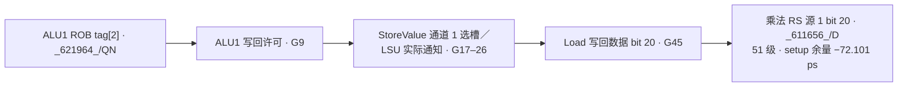

固定网表折算 **480／490／495／500 MHz** 分别有 **0／117／444／842** 个缺口。本次新增 **32** 个 ROB 身份 FF 全部计时，**227** 个 SRAM 宏逐实例一致。PRF 写数据违例 **1405→236**，原最差 `P45.wd_in[17]` 余量 **−91.790→+36.823 ps**。证据 `.cpu2026-synthesis/load-writeback-identity-ppa-20261121-r02/{result,group-comparison}.json`。

**842 个违例端点。** 按终点分为 FF 数据端 **566**、PRF SRAM 写数据 **236**、D$ SRAM `ce_in` **40**。按每端点最差路径起点分为 ALU1 **478**、ROB `head[0]` **241**、AGU **114**、ROB `head[2]` **8**、LSU **1**。PRF 空闲表占 **241**，新增身份 FF 无违例。逐点表 `.cpu2026-synthesis/production482-endpoint-list-20261121-r01/violating-endpoints.tsv`。

**当前 ROB `head[2]`→D$：490 MHz 差 30.713／20.169 ps。** `readWayMaskInner[1:0]` 共用前 **35** 级（约 **1470 ps**）。G7 为退休通道 1 的 SQ 槽号位 0 反相，G8–9 为该通道未选 SQ6，G18 为 `postedStoreMaskInner[4]`（**922.7 ps**）；后段经 LSU 请求、D$ 查找与 way 有效位选择。整核 pre-ABC 四路均证明 LSU 实际 Store 退休等于 ROB 实际 `retirementFire && isStore`；下文的授权复用版已独立测量，未提频。

**生产掩码的门级复核。** `head[2]` `_617346_/QN` → way0 `_610653_/D`、way1 `_610654_/D`，到达／要求约 **2018／1957 ps**、**2012／1941 ps**。G35→G44 分别约 **389／410 ps**；两个 way 都到 G45 才开始各自并入 128 个有效位，无 SRAM 时序弧。同一 `head[2]` 到 `readValid` 仍余 **259.969 ps**。固定 reset、其余旧寄存器和 SRAM 输出，只翻转 `head[2]`（或单独翻转 AXI 写队首 `[0]`）：若两侧都获读授权，槽号、实测数据宏的七位 set 地址及两路掩码 D 均不变；若只一侧读，D 可变，未读侧确实保持旧值。逐门同时翻转在不限制读授权时可到 G32、G33 无解；限制两侧都读时可到 G28、G29 自身即不翻转。是稳态单起点布尔诊断，不作假路径签核，不改 STA 约束。证据 `.cpu2026-synthesis/production482-dcache-mask-detail-20261122-r{01,06,08}/result.json`、同名前缀 `r02/way0-support.json`。

**重查生产瓶颈：晚到的是选路，不是有效位数据。** 限起点 STA：256 个 `validInner` FF 到两路掩码最晚 **285.5／251.9 ps**，最差余量 **+1671.681／+1705.346 ps**；AGU 和 SQ 地址不经 ROB 发射也分别到 way1 **−58.617／−56.166 ps**，490 MHz 仍超。请求槽 set 位与 AXI 写队首均在 ROB 路径的 **G29** 汇入，并到 way1 共用最后 **23** 级输出门。`head[2]` 经完全相同的前缀到 G35（**1470 ps**）后，`readValid` 还需 **203 ps**，way1 还需 **542 ps**；差 **339 ps** 是同点分叉实测差，不是可直接删掉的延时。证据 `.cpu2026-synthesis/production482-dcache-mask-bottleneck-20261122-r01/result.json` 及同目录逐路径 JSON。

**核对生产 pre-ABC 选路。** 两路实际读授权互斥，未读保持，旧请求数据索引确实含 `lookupInner` 的 **3** 个门控行号位，新请求则读 CPU 请求的 set。授权下换索引的完整 D 端等价已证，但候选仲裁自身不独立于 `fillBeat`、请求 `write` 和上次 `readValid`；固定其他边界做内部节点切断时三者均能改变候选。这解释该改动只切掉下游的一处依赖；没有把上游仲裁提前。证据 `.cpu2026-synthesis/production482-dcache-mask-bottleneck-20261122-r03/result.json`。

**G29～G35 的仲裁身份。** 生产映射核实：实际接受 Store（G25，反相）经槽 7 预取取消（G26）影响初筛（G27，反相）；**G29（1209 ps）是 `!(|demandLookupMaskInner) && !cpuRequestInput.valid`**，检查提案而非实际 `accept`。它先门控最终候选，再进入年龄比较：G31（**1311 ps**）是槽 5 非候选，G32（**1361 ps**）排除槽 **1、5、6** 对槽 7 的年龄阻挡，G33（**1384 ps**）是槽 7 胜出，G34/G35（**1415／1470 ps**）是槽 **4～7** 无年龄合格项。只翻 `head[2]` 时 G32、G33 各自可变但不能同变；在 `olderInner[7][7]=0` 下，G32 为高的那侧槽 7 本身不是候选，因此 G33 的 D 输入为 0，并非另一个年龄阻挡造成。两侧都读且 G28 翻转时，在 G28 为低的一侧，需求组 **0/4** 或 **2/3** 至少一组压住 G29。证据 `.cpu2026-synthesis/production482-dcache-candidate-route-20261122-r{03,05,06,07,09}/result.json`；这些稳态组合结果不作时序例外。

**需求独立比年龄、预取末级放行（独立实测，未采用）。** 复位后最多 **1** 个活跃预取槽且年龄对角位为 0，故只让需求比年龄；原预取取消、实际读授权和掩码完全不变。**73728** 组离线对照、真实 D$ **135** 次差分及 **3** 个仲裁故障反例通过，原六周期及 **374104** 条九字段退休完全一致。2.0 ns 整核 **475.615420 MHz／33849.02 μm²／IPC 1.108096761**（较生产 **−1.440%**，较 W8／S **+19.194%／+12.634%**）；setup 违例 **842→2136**，490 MHz 缺口 **117→617**，新最差 AGU `auxiliaryOutput[0]`→整数 RS 操作数（**−101.600 ps**）。D$ `ce_in` 缺口 **3→0**，但 way0/1 掩码余量 **−60.985→−63.019／−71.529→−69.443 ps**，仍均未达 490 MHz。完整计时 **28186** 项、**227** 个 SRAM 宏逐实例一致，无未解决警告。证据 `.cpu2026-synthesis/production482-dcache-prefetch-last-20261122-r01/{result.json,01-prefetch-last/group-comparison.json}`。与历史仅拆 SRAM 地址的旧 2.5 ns 版本不同，不叠加、不复跑。

**同起点复核。** 固定 AGU `auxiliaryOutput[0]`→同一整数 RS 操作数位，两版都是 **53** 级，数据到达 **1891→2038 ps**，setup 余量 **+49.972→−101.600 ps**；同起点到乘法 RS 同终点也从 **+14.331→−68.417 ps**。候选 **589/617** 个 490 MHz 缺口共用该 AGU 起点的前 **42** 级（**1667 ps**），不是独立的末级退化。这是整核重映射的实测差异，未归因到某一颗单元或某个 RTL 算式。证据 `.cpu2026-synthesis/production482-dcache-prefetch-last-cause-20261122-r02/result.json`。

固定候选网表、乐观排除这 **589** 点仍有 **28** 点不到 490 MHz，最慢为 D$ way1 掩码，尚差 **28.627 ps**、余下端点给出约 **483.222 MHz** 上界；未计替代路径，不是重映射预测。

**换方向：先筛 LQ6，寄存器不插流水拍。** ROB16／PRF48 已到当前配置下限；旧 SQ4 已按用户要求回退，不恢复。`LQ_ENTRIES` **8→6** 保持 3 位槽号和 8 个运输 owner，源码的树可填空叶；每个 LQ×SQ 查询阵列从 **64→48** 项，可同时减小 Load 通知和 D$ 请求仲裁上游的选路规模，不能保证提频。IPC 只容许约 **0.73%** 的下降，应先筛原六 IPC 和完整九字段退休，再决定是否综合。

LQ6 已通过六槽回压、8 个运输 owner、取消后复用和两个注入故障；原六 **374104** 条九字段退休一致。几何 IPC **1.104797083**，高于 1.10；只有 towers **5881→5987** 拍、rsort **168045→168050** 拍，其余不变。证据 `.cpu2026-synthesis/production482-lq6-20261122-r05/01-lq6/independent-audit.json`；这只是功能与 IPC 结论。

**LQ6 初步 2.0 ns STA（覆盖审计待闭合，未采用）。** Fmax **470.372072 MHz**、面积 **33329.26 μm²**、setup 违例 **842→1110**。原最差乘法 RS 端点余量 **−72.101→+24.974 ps**；同一 D$ 数据宏 `ce_in`（way1/bank2/lane0）则 **+27.619→−125.565 ps**，最差起点从 AGU 变成 ROB `head[0]`。490 MHz 下 D$ 使能缺口 **3→66**，LQ6 的 66 条最差记录共用起点后 **43** 级。LQ 参与同拍 Load/Store 端口仲裁，因而即使 D$ RTL 不改，其使能的上游逻辑及整核映射也会变；未将差额归因到单门或运行时预取。证据 `.cpu2026-synthesis/production482-lq6-20261122-r05/{result.json,01-lq6/endpoints-candidate/}`。

固定同一起终点 `head[0]`→way1/bank7/lane1 `ce_in`：余量 **−28.493→−116.020 ps**，同为 **47** 级；LQ6 到第 35 级还早约 **38 ps**，但第 36–40 级累计约 **339 ps**（生产约 **164 ps**，级号不保证逻辑对应）。支持使能后段重映射退化，不支持“LQ 选择树直接多了级数”。生产定向证据 `.cpu2026-synthesis/production482-rob-readmask-review-20261122-r01/production/head0.{json,tsv}`。

**LQ4（功能和 IPC）。** 保留 SQ8、8 个运输 owner 与三位共享 AGU 槽号；Load 槽缩为两位并核对原索引范围。真实 LSU **50** 拍及两个故障反例通过，原六答案和 **374104** 条九字段退休一致。几何 IPC **1.107058860**，较 LQ8 **−0.094%**、较 LQ6 **+0.205%**；vvadd **3260→3124** 拍，towers **5881→6182** 拍。证据 `.cpu2026-synthesis/production482-lq4-ipc-20261122-r02/result.json`。

**LQ4 高于 LQ6 的来源。** `vvadd` 加法循环均 **1973** 拍，校验阶段 **1138→1008** 拍、收尾 **34→28** 拍；若只换回 LQ6 的 `vvadd` 周期，LQ4 几何 IPC 为 **1.099224**。复用 converted 模型逐拍观察：校验数组两版均读取同样 **38** 行（**36** 预取、**2** 需求），逐行读握手至回填耗时相同，D$ 未拒绝 Load 请求。稳定段 **33** 行，前一行回填后第一拍，LQ4 满且无 CPU 请求，下一行预取可入队；LQ6 仍发需求，预取晚 **1** 拍入队、入队后又多 **3** 拍才查到。相对首个需求，到齐等待 **15→4** 拍；`0xdc` 的直接命中返回 **190→227/300**。证据 `.cpu2026-synthesis/production482-vvadd-lq-profile-20261122-r01/paired.json`。未改 RTL、未综合、未采用；不外推到其它程序。

**LQ4 与 LQ8 的 D$ 对照。** 66 个 `ce_in` 全部过 500 MHz（最差 **+13.896 ps**），两条读掩码改善至 **−53.541／−48.842 ps**，仍不过 490 MHz。覆盖对照见 `.cpu2026-synthesis/production482-lq4-20261122-r03/{result.json,01-lq4/coverage.json}`；采用见[当前生产](#当前生产)。

**无新增流水拍的 D$ 寄存备选。** 每个请求槽保存对应 set 的两路**实时有效位**（共 **16 bit**），旧槽获原授权后选槽内两位，CPU 直读与未读保持不改。不保存 tag，也不是分配时只读一次的快照。既有回填、选 victim 失效必须同时更新槽副本，新分配槽按实际 CPU／预取地址应用同拍更新，保留失效优先。原方程的一拍归纳和读掩码对照通过；遗漏回填、失效或分配同拍更新有反例。新增写入路径的时序尚未测。证据 `.cpu2026-synthesis/production482-parameter-register-review-20261122-r02/result.json`；未开新 RTL 或综合。

**掩码备选：按 3+4 位预译码。** 旧槽的 set 高低段提前独热译码，赢家选两段，随后从当前 `validInner` 取两路；不复用整个 SRAM 地址，不改原读授权、CPU 直读或未读保持。对任意有效位表，六种切分（含 3+4）均通过选位等价；多赢家混拼、新请求误用旧分配槽、无读误写都构成反例。3+4 两 way 共用 **192** 个赢家选通项；每槽复制整张表则仅旧槽读已有 **2032** 个二选一等效项。是结构计数，非面积或延时。生产 way1 的 G29→G35 **261 ps**、G35→G44 **410 ps** 都不是可直接节省量。证据 `.cpu2026-synthesis/production482-dcache-route-options-20261122-r01/result.json`；历史对照 `sync/FREQUENCY400-DCACHE-LOOKUP-PRESELECT-20261112.md`。未改 HDL 或综合。

**当前 ROB `head[0]`→PRF 空闲表：490 MHz 有 17 点，最差差 14.937 ps。** 这组前 **30** 级共用（约 **1510 ps**）；G3–5 为恢复重放 `baseSlot[3]` 的反相，G13 为重放通道 0 的 `newPhy[4]`、G14 判其完整 `newPhy` 为零。前段走恢复重放，不是普通退休读 oldPhy。回收目标槽可由旧 `freeTail` 预算，**32768** 个尾位／事件组合的写槽、尾指针一致；原回收排序和实际授权不改。证据 `.cpu2026-synthesis/production482-rob-head-20261122-r01/{paths,anchors}.json`、同名前缀 `r02/replay.json`。结构及布尔等价不代表路径已敏化或能提频。

**PRF 旧尾指针预计算回收槽（未采用）。** 保留原排序、授权和所有写口；实际错槽反例检出，原六答案、周期及 **374104** 条九字段退休一致。2.0 ns 整核 **479.400749 MHz／33851.84 μm²／IPC 1.108096761**（较生产 **−0.655%**，较 W8／S **+20.143%／+13.530%**），违例 **842→2205**。490 MHz 缺口 **117→466**，不再有 ROB 队首起跳的最差记录，改由 ALU0 **341**、AGU **90**、LQ **33**、AXI **2** 限制；最差为 ALU0→PRF 写数据 **−85.527 ps**。核实 **7** 个尾指针别名后完整计时 **28186** 项、**227** 个宏逐实例一致。证据 `.cpu2026-synthesis/production482-prf-tail-preview-20261122-r02/result.json`、同名前缀 `r03/coverage.json`。

**替代起点。** 到 D$ 两个 way 掩码，490 MHz 下 `head[0]` 分别也差 **24.109／13.566 ps**，`head[3]` 差 **25.752／15.209 ps**（顺序 `[1]／[0]`）；不能只修位 2。到上述 17 个 PRF 端点，其余 head 位均满足 490 MHz，最近的是 `head[2]`，仍余 **1.201 ps**。证据同名前缀 `r04/result.json`。

**复用实际 Store 退休授权（未采用）。** 保留首次 SQ ready、完整 tag 与选槽，LSU 后段只接 ROB 已接受的 Store。实际授权故障检出；原六答案、周期、**374104** 条九字段退休与 IPC **1.108096761** 均不变。2.0 ns 整核 **478.728378 MHz／33793.89 μm²**（较当前 **−0.795%**，较 W8／S **+19.974%／+13.371%**）。违例 **842→841**，但 490 MHz 缺口 **117→189**。原 91 个 ALU1 紧端点仅余 1 个；新缺口按最差起点为 SQ 槽 2 地址位 2 **151**（共用前 **34** 级）、ROB `head[1]` **34**、ALU0 **4**。最差到 ALU1 操作数（**−88.695 ps**），同一个 D$ way1 掩码从 **−71.529→−75.050 ps**。**28186** 端点完整计时、**227** 个宏逐实例一致。证据 `.cpu2026-synthesis/production482-store-retire-grant-20261122-r01/{result,named-endpoints-490}.json`、同名前缀 `r02/path.json`。

**ROB 退休 bank 选行寄存（未采用）。** 只由各 bank 的实际退休事件推进读行；冻结、行绕回和故障验证通过，原六及 **374104** 条九字段退休保持一致。2.0 ns 整核 **474.733426 MHz／33974.96 μm²／IPC 1.108096761**（较当前 **−1.623%**，较 W8／S **+18.973%／+12.425%**），违例 **842→986**，490 MHz 缺口 **117→146**。同一个 D$ way0/bank4/lane1 `ce_in` 余量 **−19.187→−105.966 ps**，新最差起点 `head[0]`；末级单宏脚 **5.0 fF**，不是此前多宏并联重载。**16** 个新增选行 FF 全部计时，**28202** 个端点、**227** 个宏逐实例一致。证据 `.cpu2026-synthesis/production482-rob-commit-rowmask-20261122-r04/result.json`、同目录 `01-commit-rowmask/group-comparison.json`。

**D$ SRAM 使能分解（未采用）。** 写授权原样保留；旧候选存在或新请求合格只决定同一拍读使能。**16384** 组离线对照、实际读使能故障及原六完整退休通过。2.0 ns 整核 **461.677187 MHz／33886.33 μm²／IPC 1.108096761**（较当前 **−4.328%**，较 W8／S **+15.701%／+9.333%**），整核违例 **842→3416**，490 MHz 缺口 **117→2629**。D$ 控制违例 **40→16**，PRF 写数据 **236→1841**；AGU→PRF 写数据最差 **−165.403 ps**。完整计时 **28186** 项、**227** 个宏逐实例一致。证据 `.cpu2026-synthesis/production482-dcache-ce-factored-20261122-r01/result.json`。

**ALU1 组切点。** 478 条记录共用前 **4** 级；G3 为 ROB 槽 5 选通的反相，G9 为 ALU1 算术写回许可（**400.6 ps**），全部经过。G17–21 为 “StoreValue 通道 1 的 SQ 槽号不等于 5”（**785.9→992.6 ps**）；G26 为该通道的实际 Store 数据通知（**1123.0 ps**），G35 后缓冲 G36 仍覆盖 **466** 条。G45 的端口别名指向 Load 写回数据位 20（**1890.9 ps**）；乘法 RS 最后 **117.8 ps** 是操作数捕获，未启用同拍发射旁路。最差路径含 **16** 级缓冲、约 **828 ps**，不能视为可直接扣除的延时。证据 `.cpu2026-synthesis/production482-alu1-cut-20261121-r01/{path,identities}.json`、同名前缀 `r02/trace.json`。

**敏化。** 单独翻转 G45，末六级的 STA 翻转可由新分配捕获触发；旧项唤醒也能改变 D，但不能复现这条末段的逐级翻转。固定其他输入只翻转 ALU1 起点，G1–27 可复现；加上 G28 就不行，G15 下降与 G28 上升不能同时成立（`r03/localize.json`）。不据此删路径。即便 ALU1 组全部消失、其余端点不变，另一路 ROB `head[2]`→D$ `readWayMaskInner[1]` 仍差 **71.529 ps**。

**ALU1 与 D$ 掩码没有共同限频段。** 生产 490 MHz 下的 **91** 条 ALU1 最差记录与两条掩码路径，共同门、脚、网均为 **0**；两组任何在路径上的门连对侧终点的组合锥都不在。完整锥虽共享 **11341** 个组合输出，但两个代表起点都到不了这些共享节点。ALU1 经过 Store 数据到达通知（从 StoreValue 槽发往 Load 写回），D$ 经过 ROB 实际退休和 posted-Store 仲裁（决定缓存端口）。共用旧 SQ 状态不等于共用晚路径；不再找一个 Store 门同时解这两组。证据 `.cpu2026-synthesis/production482-dual-bottleneck-overlap-20261122-r02/result.json`。

**StoreValue→LSU 预查（未采用）。** 两个旧 StoreValue RS 行先查 SQ／通知资格，晚授权只选原行，保留排序与两路 ALU 旁路。原六答案、周期和 **374104** 条九字段退休相同，IPC **1.108096761**；定向覆盖错 epoch、两路同拍及通道错接。2.0 ns 整核 **475.836431 MHz／33791.78 μm²**（较当前 **−1.394%**，较 W8／S **+19.250%／+12.686%**）；ALU1 tag[2] 组 **478→0**，整核 **842→2028**，PRF 写数据 **236→753**。最差为 ROB `head[2]`→D$ `readWayMaskInner[0]`（**−100.857 ps**）。490 MHz 缺口 **117→594**：新图最差起点为 `haltedOutput` **370**、LQ `tag[6][1]` **222**、ROB `head[2]` **2**。核实 **94** 个 RS 端口别名后，**28186** 个端点完整计时、**227** 个宏逐实例一致。证据 `.cpu2026-synthesis/production482-sv-prequal-20261122-r07/result.json`、同名前缀 `r10/coverage.json`。

**Load 写回分别准备缓存／Store 转发／缓冲结果（未采用）。** 原六答案、周期与 **374104** 条九字段退休相同。2.0 ns 整核 **477.166822 MHz／33801.16 μm²／IPC 1.108096761**（较生产 **−1.118%**，较 W8／S **+19.583%／+13.001%**），违例 **842→1160**，490 MHz 缺口 **117→183**。原 91 个 ALU1 紧端点仅余 7 个，但新 `head[2]`→PRF 空闲表占 **131** 个，最差 **−95.317 ps**。完整计时 **28186** 项、**227** 个宏逐实例一致。证据 `.cpu2026-synthesis/production482-load-value-mask-20261122-r01/{result,named-endpoints-490}.json`。

**RS 普通 CDB 捕获独热选数（未采用）。** 先比各端口的完整物理 tag 和有效位，仍由原最低编号胜者供数，旁路策略不变。实际丢写反例检出，原六答案、周期与 **374104** 条九字段退休一致。2.0 ns 整核 **474.513438 MHz／33779.56 μm²／IPC 1.108096761**（较当前 **−1.668%**，较 W8／S **+18.918%／+12.373%**），违例 **842→1729**，490 MHz 缺口 **117→653**。原 91 个 ALU1 紧端点仅余 2 个；AGU `auxiliaryOutput[2]` 新占 **499** 个缺口，最差到 PRF SRAM 写数据 **−106.629 ps**。完整计时 **28186** 项、**227** 个宏逐实例一致。证据 `.cpu2026-synthesis/production482-rs-capture-onehot-20261122-r02/{result,named-endpoints-490}.json`。

**LSU 完整转发查询复用已认证的 AGU tag（未采用）。** 原 LQ 完整 tag、flush 与请求授权保留；强制错包由原 cache-block 断言检出，原六周期及 **374104** 条九字段退休不变。2.0 ns 整核 **473.197782 MHz／34057.49 μm²／IPC 1.108096761**（较当前 **−1.941%**，较 W8／S **+18.588%／+12.061%**），违例 **842→2408**，490 MHz 缺口 **117→529**；新最差 flush 队列→整数 RS（**−112.355 ps**）。完整计时 **28186** 项、**227** 个宏逐实例一致。证据 `.cpu2026-synthesis/production482-lsu-agu-full-tag-20261122-r02/result.json`。

### 490 MHz 横比与接续

生产加八个独立候选按同一终点对照：原 ALU1 最差终点在 **6/8** 个候选满足 490 MHz，D$ 两个 `readWayMask` 则 **9/9** 都不满足，是唯一贯穿全部映射的两个紧端点。**经验：** 起点分组归零不代表路径消失；局部改善不能代替整核 Fmax 和完整违例端点对比。StoreValue 的行号／数据通道错序由整核 `vvadd` 检出，跨模块侧带须核对实际端口顺序和授权，并保留有效反例。

**读掩码不是 ROB 选行或 SRAM 地址。** 九份网表两个终点都是 D$ FF 的 D 端，不经 SRAM 时序弧，路径 **48–52** 级、各版两路共用前 **31–44** 级。较慢掩码距 490 MHz **27.159–60.041 ps**；D$ SRAM 地址 **9/9** 通过（最小余量 **13.501 ps**），`ce_in` 在 **4/9** 超时；`readValid`、请求槽号、偏移与大小 FF 在 2.0 ns 下也全部有余量（最小 **49.412 ps**）。生产 way1 的 G18 是 posted Store 掩码一位（**922.7 ps**），两路共用至 G35（约 **1470 ps**）；way1 从 G45（约 **1915 ps**）起并入该 way 的 **128** 个 `validInner` FF，至 D 约余 **97 ps**。这是组合锥证据，不证明整条路径已敏化。

**定向 STA：不能只切 ROB `head[2]`。** 生产 way1 在 490 MHz 下，`head[0:3]` 分别欠 **24.109／0.950／30.713／25.752 ps**，AXI 写队首 `[0]` 也欠 **9.250 ps**。PRF 回收槽版以同一 AXI 位最差（欠 **32.756 ps**），原 ROB 四位到 way1 仍全部超时。ROB 寄存选行版令 `head[2]` 到 way1 的 2.0 ns 余量 **−71.529→+145.485 ps**，但 `head[0]` 变成最差（**−72.437 ps**），且同起点到最差 `ce_in` 共前 **34** 级，**66** 个 D$ `ce_in` 均未到 490 MHz。若只修生产两路掩码、其余路径不动，490 MHz 仍差 **115** 个端点，最差仍是 ALU1→乘法 RS。原网表定向报告（**1490** 条所选路径复核）和生产结构证据 `.cpu2026-synthesis/production482-rob-readmask-review-20261122-r02/result.json`、同名前缀 `r01/production-support.json`。

**旧请求掩码改用候选行号（独立实测，未采用）。** 只在原 `lookupInner >= 0` 授权分支用 `lookupCandidateInner` 取行，不改 SRAM 地址或更新条件。**36864** 组离线对照、真实 D$ **124** 次差分及两个故障反例通过，原六周期与 **374104** 条九字段退休一致。2.0 ns 整核 **387.585163 MHz／33899.32 μm²／IPC 1.108096761**（较生产 **−19.682%**，较 W8／S **−2.867%／−8.213%**），setup 违例 **842→2805**，490 MHz 缺口 **117→1682**。两个掩码余量 **−60.985→−46.544 ps／−71.529→−57.921 ps**，离 490 MHz 仍差 **5.728／17.105 ps**；D$ `ce_in` 缺口 **3→0**。新瓶颈 I$ `headInner`→`requestInstructionInner[0][1]`（**−579.200 ps**）。完整计时 **28186** 项、**227** 个 SRAM 宏逐实例一致，无未解决警告。证据 `.cpu2026-synthesis/production482-dcache-queued-mask-20261122-r05/{result.json,01-queued-mask/group-comparison.json}`。

**限频复核。** 新最差终点在生产余 **+270.074 ps**。两版 `u_axi_fetch.consumeInner` 都接 **16** 个 I$ SRAM 写使能脚，候选重映射后由 `HB1xp67` 改为 `O2A1O1Ixp33` 直接驱动 **80.5 fF**，该级用 **943.5 ps**；490 MHz 下 **1378** 个缺口的最差起点为 I$ 队首。I$ RTL 未改，是与较早单路位图版相同位置的重载映射问题，不能用局部掩码改善抵消。证据同一实验的 `01-queued-mask/{endpoints-candidate/all-violating-worst-paths.json,ppa/opt/mapped.v}`。

该单项与 477 版**复用 SRAM 集合地址**不同；`8305fa8`（原 `9f8de4d`）**删除掩码 FF、在命中 / victim 阶段再读有效位**并同时扩容，也不是同一实验。前八版横比与最初 **4096** 组取行对照保存在 `.cpu2026-synthesis/production482-490-round-review-20261122-r01/{summary,queued-mask-index}.json`。[清理前的生产证据入口](history.md#证据边界)。

### 较早的 ROB 位图候选

**五路存活查询统一走位图（未采用）。** BRU、ALU0/1、MUL、DIV 只换存活位，保留原元数据和授权。真实 converted ROB 验证 **8273** 拍，五路错误 epoch 反例均检出；原六周期、通道和 **374104** 条九字段退休不变。2.0 ns 整核 **471.672041 MHz（−2.257%）／33792.26 μm²／IPC 1.108096761**，较 W8／S **+18.206%／+11.700%**。每端点最差路径以该 ALU1 tag 位起跳的违例 **478→0**，但整核 **842→1184**：FF 数据 **566→609**、PRF 写数据 **236→575**、D$ 使能 **40→0**。新瓶颈 ROB `head[2]`→D$ `readWayMaskInner[0]` 差 **119.538 ps**，完整计时 **28186** 项、**227** 个 SRAM 宏逐实例一致，无未解决警告。证据 `.cpu2026-synthesis/rob-all-lookup-bitmap-20261121-r05/{result.json,01-bitmap/group-comparison.json}`。

**退化复核。** 原最差乘法 RS 位余量 **−72.101→+5.844 ps**；同一个 D$ `readWayMaskInner[0]` 从 **−60.985→−119.538 ps**，两版结构锥均无位图 FF。该路径从 **50→47** 级，但新映射一颗 NOR5 在 **11.85 fF** 负载下用 **252 ps**。新 PRF 写数据违例按最差起点为 SQ 槽 0 地址位 3 **447**、flush 队首有效位 **128**；同一 `P23.wd_in[17]` **+36.793→−92.954 ps**。这是整核重映射后的路径变化，不能归因于单个查询端口或位图 FF 扇出。证据同目录 `remap-diagnostics.json`。

**逐端口 PRF 结构对照。** 两份 pre-ABC 网表中，只有 BRU 查询口 `0` 到 PRF 无同拍组合连接：其恢复请求先写 flush 队列。ALU0/1 分别经 CDB0/1，MUL/DIV 经共享 CDB2；四路各自可达全部 **1504** 个 PRF 写数据脚和 **47** 个写使能脚。零结构连接不保证重映射时序不变；未测 BRU 单切。证据同目录 `lookup-prf-cones.json`。

**优化基线对比：优先当前生产。** 490 MHz 固定网表缺口为生产 **117／31.285 ps**、五路版 **136／78.722 ps**（端点数／最差缺口）。生产 ALU1、ROB→D$ 两组各差 **31.285／30.713 ps**；五路版 SQ→LSU／PRF、ROB→D$ 各差 **52.138／78.722 ps**。乐观排除各版这两组已记录端点后，490 MHz 仍差 **24／43** 项，固定网表上界约 **486.440／483.187 MHz**，不含替代路径或重映射影响。五路版 SQ 组 **759** 条共用前 **29 级**，有集中切点，但与 flush 组并非同一主干：按记录的最差路径，没有门同时覆盖两组各至少两条。生产优先核查 StoreValue→LSU 选槽与独立 ROB→D$，不把五路版当父版。证据同目录 `optimization-frontier.json`。

**仅 ALU1 端口 5 走位图（未采用）。** 原六答案、周期、通道及 **374104** 条九字段退休不变，ALU1 错误 epoch 反例检出。续用完整展开和 SRAM 准备，2.0 ns 整核 **417.448023 MHz（−13.494%）／34003.09 μm²／IPC 1.108096761**，较 W8／S **+4.617%／−1.141%**。按最差起点计 ALU1 组 **478→0**，但整核违例 **842→1147**；PRF 写数据 **236→427**，D$ SRAM 地址 **0→44**。新最差为 I$ `headInner`→AXI 取指 `linesInner[3][16]`（**−394.778 ps**）；480 MHz 的 **372** 个缺口均以该 I$ 队首起跳。**28186** 项完整计时、**227** 个 SRAM 宏逐实例一致，无未解决警告。证据 `.cpu2026-synthesis/rob-alu1-lookup-bitmap-20261122-r02/{result.json,01-alu1/group-comparison.json}`。

**单路退化复核。** 原乘法 RS 最差位余量 **−72.101→+71.323 ps**，但同一 I$→AXI 端点 **+59.492→−394.778 ps**。`u_axi_fetch.consumeInner` 两版均带 **16** 个 I$ SRAM 写使能脚（合计 **80 fF**）；重映射从 `HB1xp67` 换为小 `NOR2xp33`，实际总负载 **83.59→81.39 fF**，该级延时 **509.8→955.5 ps**、转沿 **1.089→2.038 ns**。480 MHz 的 **372/372** 个缺口全经过该门。负载超出单元库 **23.04 fF** 查表上限；这是当前理想时钟模型的诊断，不是后布局计时。证据同目录 `fetch-regression-r02/result.json`。

### 前生产 478.058：LSU 写回→PRF

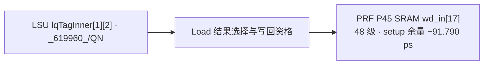

数据到达约 **1.9918 ns**、要求 **1.9000 ns**。固定网表折算 480 MHz 有 **102** 个缺口（PRF 数据／D$ 地址／其余 **65／36／1**）。原 D$ 最差脚余量 **−106.154→+9.768 ps**；2.0 ns 下 D$ 地址违例 **392→176**，PRF 数据违例 **963→1405**。原六答案、周期、完整退休不变，**227** 个 SRAM 宏逐实例一致。证据 `.cpu2026-synthesis/dcache-lookup-winner-20261121-r03/{result,group-comparison}.json`。

**前生产 LSU 叶节点切点。** PRF 的 65 个紧端点至少共用前 **36** 级；G5 已判槽 0/1 谁胜出（**256.2 ps**），G17 为八槽缓冲胜者 tag 位 1 的反相，G20 为槽 2 回包的年龄资格。可复用已有 `loadPairOlderCachedInner[1][0]`，叶方程 **65536** 组合一致；此小切点未实现，不能推断整核收益。证据 `.cpu2026-synthesis/production478-lookup-lsu-cut-20261121-r02/path.json`、同名前缀 `r03/{identities,pair-theory}.json`。

**后段边界。** G28 为写回 ROB tag 位 4、G37 为实际写回资格，均反相；两点间约 **307.8 ps**，不是 Load 数值计算。G17→G20 约 **128.9 ps**，可另研究按缓冲胜者物理行选已知年龄关系；反向不能简单取反，半圈距离两向都不算更老。保留真实回包身份、flush 与 ROB live 检查。证据同名前缀 `r07/late-equivalence.json`。

**500 MHz 口径。** 前生产固定网表在 **480／490／495／500 MHz** 分别有 **102／918／1703／2347** 个缺口。500 MHz 下按各端点最差路径的起点分组，LSU `lqTag[1][2]`、ROB `head[1]`、ROB `head[0]` 各占 **1415／277／189** 个，组内最差缺 **91.790／88.060／87.495 ps**。证据 `.cpu2026-synthesis/dcache-lookup-winner-20261121-r03/endpoints-candidate/all-timed-endpoints.tsv`。

**写回资格前移的布尔切点。** 前生产网表证明 D$ 两预览授权互斥；LSU 有效包自带同一 flush 判定、tag 等于原胜者的完整 tag。可提前查 ROB 身份，最后只取原胜者的资格位，不改发次名；保留 recovery／包有效门禁。该证据仅证明前生产的组合等价。证据 `.cpu2026-synthesis/production478-writeback-prequal-20261121-r01/result.json`。

**寄存切点 IPC 对照。** 同拍版 IPC **1.108096761** 并保持原六周期；多一拍版 IPC **1.059951699**（**−4.345%**），未过门槛、未综合。两版原六答案和 **374104** 条九字段退休均一致。证据 `.cpu2026-synthesis/load-writeback-ipc-20261121-r02/result.json`。

### 前生产 474：ROB 队首→D$ 地址

三槽 RAS、D$ 以槽号选 set：**474.733426 MHz／33722.95 μm²／2261 个 setup 违例**。

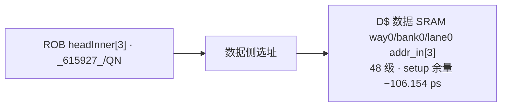

2.0 ns 下到达／要求约 **2.0062／1.9000 ns**。同脚最差余量较四槽 **−72.093→−106.154 ps**；RAS 槽 PC 违例 **120→0**，余下 96 个 PC 位最差 **+123.111 ps**。计时覆盖少 70 项，正好对应移除的 **36** 个 RAS FF 和一只 `1×32` 宏的 **34** 个计时端点，其余 **227** 个宏逐实例一致。按固定网表延时折算，480 MHz 仍有 **221** 个缺口（D$ 数据宏地址 148 个），最差差 **22.821 ps**。证据 `.cpu2026-synthesis/ras3-from478-20261121-r02/01-ras3/group-comparison.json`、`.cpu2026-synthesis/ras3-production-20261121-r01/adoption.json`。

**480 MHz 缺口分组（每端点取一条最差路径）：** ROB `headInner[3]`→D$ 地址 **136／22.821 ps**（共用前 39 级，地址位 0/2/3/5）；ROB `headInner[1]`→PRF 空闲表 FF **7／13.205 ps**；LSU `lqTagInner[6][0]`→ALU1 输入及执行结果寄存器 **50／8.672 ps**（共用前 46 级）；D$ 请求槽 `requestInner[0][54]`→D$ 地址 **12／7.907 ps**；I$ 队首→I$ 数据宏 `addr_in[3]` **16／6.324 ps**。数字为端点数／最差缺口，无 RAS。证据：三槽 `endpoints-candidate/{all-timed-endpoints.tsv,all-violating-worst-paths.json}`。

**旧网表切点。** G21＝`!postedStoreMaskInner[7]`，G27＝`!storeSendSelectedInner`，G28＝`!(acceptInner && write)`，G30＝预取槽 3 取消；G37 已判出槽 7 胜出，G39 编成候选号 bit 1，G43 又解码低三位是否等于 7，G47 为查询 set 位 3 的反相。G37→G47 **432.4 ps** 含地址组合和分发，不是可直接节省的量；末级驱动四个宏脚（**20 fF／179.0 ps**）。现生产把 set 与槽号分路，保留原授权、最高槽平局及无胜者回退。旧网表只翻转 ROB 起点时，裸地址及使能可变，但两侧同读或同写的地址不变；从 G39 单独翻转则能改变有效读地址。不作假路径签核。证据 `.cpu2026-synthesis/production474-dcache-cut-20261121-r03/{authorization,equivalence}.json`、同名前缀 `r04/address-oracle.json`。

**独立 LSU 切点。** 50 个 LSU→ALU1 端点共用的 G4 是 LQ 槽 7／6 的 tag 差符号，G6 已选出该叶对胜者的 tag 位 1（反相，**65536** 组等价）。可研究只复用已有 `loadPairOlderCachedInner[7][6]`，保留原树、授权和平局；该年龄 FF 在 2.0 ns 下余量 **−8.193 ps**。证据 `.cpu2026-synthesis/production474-dcache-cut-20261121-r06/lsu.json`。此方向未改 RTL 或启动实验。

### 前生产 478：恢复偏移→RAS

四槽、SQ 队首 Store 集合预览版：**478.952292 MHz／33877.950987 μm²／IPC 1.109294605**。2.0 ns 下 **2284** 个违例，WNS **−87.887 ps**，TNS **−75.121 ns**，共 228 个宏。以下 RAS 路径和频率分档来自该旧网表。

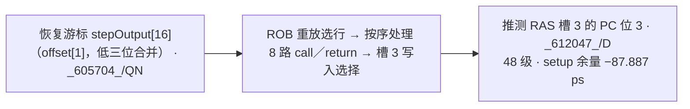

**起点与可达性。** 23 位 `stepOutput` 的 `first` 是 `[21]`；`[16]` 是 `offset[1]`。映射前已把 `offset[2:0]` 合到同一 FF。复位和开始恢复时偏移清零，随后只保持或加 8，故低三位始终为零；映射后也验证了 `QN=1` 时 `D=0`、异步置位无效。这只 FF 在正常复位后没有 STA 所列的发射边沿。

**共享延时。** 固定网表下 478 MHz 无缺口，480 MHz 的 **10** 个超时端点全是 RAS 槽 3 的 PC 位，最差缺 **4.554 ps**；其最差路径从 QN 共用前 **45/48 级、1897.2 ps**，代表位分叉后的末三级仅 **67.4 ps**。2.0 ns 下有 **122** 个违例以该 QN 为最差起点（120 个槽 PC 位、2 个栈深位）。同一槽 3 位 3 的余量由前生产 **+38.096** 变为 **−87.887 ps**；原 D$ 掩码位则由 **−94.433** 改善到 **−64.178 ps**。

**门级等价。** G2 是 `head + offset` 低三位向位 3 的进位，G3 是 `baseSlot[3]`，G9 是第 0 路所选 ROB 行的 return 动作。恢复有效时，G14 是进入第 1 路的栈深位 1，G32 是进入第 6 路的栈深位 1，G37 是进入第 7 路的栈深位 0 的反相；G43–45 都等于“第 7 路写槽 3”的反相。G9 输出到 G37 输出用 **1186.6 ps**。这是门输出函数的等价证明，不是运行中整条串联路径同时翻转的证明。证据 `.cpu2026-synthesis/production478-offset-ras-20261121-r02/anchors.json`、同名前缀 `r03/anchors.json`。

**两个诊断不能互换。** 保持原约束，仅查其他起点到这些端点，ROB `headInner[1]` 仍经同一进位门到槽 3，最差 **−87.087 ps**，480 MHz 仍差 10 个端点。另在隔离 STA 中把 QN 固定为复位后值，让常量传播：原槽 3 位 3 变为 **−77.852 ps**，全核最差转为 LSU `lqTagInner[2][1]` → Store 地址保留站 `src1ValueInner[0][10]`（**−79.430 ps**），480 MHz 缺口为零。后者少计了偏移 FF 自身 D 端，覆盖 **28223/28224**，不是生产成绩。证据 `.cpu2026-synthesis/production478-offset-ras-20261121-r01/{result,alternate,fixed-offset/result}.json`。

**与旧对齐方案的区别。** 476 版曾在 ROB 选行处用 `head ^ (offset & 8)` 替代加法，保留完整游标；另测过直接取 `nextTag`。两者都降频。旧 XOR 的实际改动见 `.cpu2026-synthesis/rob-replay-aligned-xor-20261120-r01/run.py`。

**游标偏移高位实测（从 478.952 独立，未采用）。** 8 路配置只寄存高位，低三位接零，最后一拍照常推进。8／4 路游标逐拍对照和两项故障反例有效，原六答案、周期及 **374104 条九字段退休记录**一致。2.0 ns 整核 **428.990364 MHz／34037.38 μm²／IPC 1.109294605／3688 个 setup 违例**，较生产 Fmax **−10.432%**、违例 **+1404**，较 W8／S **+7.509%／+1.592%**。完整覆盖 **28224→28223**，差一项是原合并低位 FF 被移除；228 个 SRAM 宏一致，无未闭合警告。

**重映射结果。** RAS 槽 PC 违例 **120→0**、最差余量 **−87.887→+39.473 ps**，但 480 MHz 缺口 **10→1427**。新瓶颈为 I$ `headInner` → 分支预测 checkpoint `ckptGhrInner[30][7]`（**−330.514 ps**）；同一终点在生产为 **+265.557 ps**，最差起点原为 IQ 队首。按各端点最差路径分组，AGU→PRF 写数据余量 **−64.950→−86.319 ps**，AGU→保留站 **−72.059→−87.661 ps**，但旧 `PRF[9].wd_in[6]` 反而改善。隔离 STA 的固定网表结果不能预测重映射。证据 `.cpu2026-synthesis/recovery-offset-units-20261121-r03/{result.json,01-offset-units/group-comparison.json}`。

**AGU 对照。** 旧“两条一组”从 476 版出发，虽清零 RAS 槽 PC 违例，却把同一 AGU→PRF 写脚拖慢 **243.980 ps**（见下文独立候选）。在当前生产的逐端点最差路径表里，按固定延时折算到 480 MHz，旧脚 `PRF[9].wd_in[6]` 余 **37.533 ps**；由 AGU 起跳的记录中，`PRF[28].wd_in[23]` 只余 **18.383 ps**，整数保留站 `src2ValueInner[1][5]` 只余 **11.274 ps**。评估游标编码应同时对照这些路径和全核端点，不重试 RAS 成对并行。证据：当前生产 `endpoints-candidate/all-timed-endpoints.tsv`、`ras-pair-agu-displacement-20261120-r01/result.json`。

### 478 版的历史频率分档

固定生产网表延时，**480／482／485／490 MHz** 分别有 **10／52／224／781** 个超时端点；480 全在推测 RAS 槽 3，482 另有 **42** 个起自同一 LQ tag 位。即使完全解决 RAS，其他延时不动也只到 **480.901 MHz**。485 时 LSU／AGU 起跳分别占 **101／70** 个，不能只盯 RAS。

- **三槽 RAS 的筛选依据。** 移除槽 3，栈深由 3 位降为 2 位，仍是每拍 8 路的标量重放。按原六全部 **374104** 条退休重放，176 次返回中，4→3 仅 towers 有 **6 次**栈顶目标或空状态不同，其中 **4 次**由正确目标变成错误或空；4→2 则是 **14／12 次**。这不是投机取指模型。若仅 towers 增拍，最多 **302** 拍仍过 IPC 门槛。
- **更高频率：LSU 缓冲结果树的一处二选一。** 482 MHz 下 42 个 LQ 端点的最差路径共用前 **24 级（约 1050 ps）**；G6 对两个完整 5 位 tag 和 6 个资格位穷举 **65536** 组，等于“槽 3 胜过槽 2”。现有寄存位 `loadPairOlderCachedInner[3][2]` 正是所需旧年龄关系，只建议研究用它替换这一叶对的年龄比较，保留有效位、平局和原树；不增流水、不改变实际授权。2.0 ns 下 **531** 个违例的已存最差路径经过 G6，480 MHz 的 10 个 RAS 端点均不经过它。已有年龄 FF 的 QN 直接负载为 6 个输入脚，新增负载和其余路径可能抵消收益。

上述频率分档与返回轨迹为离线筛选，证据 `.cpu2026-synthesis/production478-frequency-screen-20261121-r01/{result,leaf}.json`。

### 前生产 477：ROB→D$

ROB 分配拍保存 RAS 动作：**477.389277 MHz／33766.647267 μm²／2000 个 setup 违例**，WNS **−94.433 ps**、TNS **−53.418 ns**。下列路径定位均来自 477 网表。

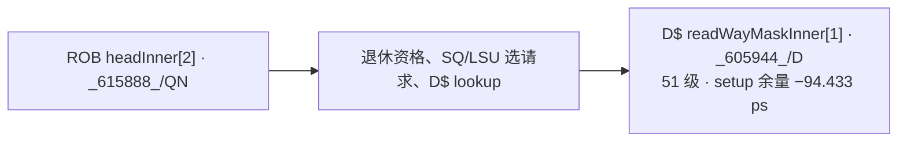

固定 477 网表延时，**478 MHz** 尚差此点 **2.383 ps**；**480 MHz** 尚有 **22** 个缺口，含 **17** 个 D$ 端点。较 476 版，RAS 槽 PC 违例 **128→0**，最差余量 **+15.037 ps**；新增 **32** 个动作 FF 全部计时，最差 **+296.379 ps**。证据 `.cpu2026-synthesis/rob-ras-action-register-20261121-r04/audit.json`。

**延时拆分：** 到达／要求约 **2.0537／1.9592 ns**；51 级组合约 **1.976 ns**，其中与 16 个 D$ 地址脚共用的前 33 级约 **1.307 ns（66%）**。第 29–44 级 D$ 选路段约 **676 ps**，第 45–51 级汇入 way 有效位后约 **198 ps**。固定其余延时，仅消除掩码缺口后约受 `addr_in[4]` 限制在 **478.57 MHz**，消除全部 D$ 缺口后约受 AGU→除法发射限制在 **479.22 MHz**。这些是固定网表上界，不是重映射预测。证据：生产报告同目录 `timing.rpt` 和全端点表。

**前 33 级逐门复核：** 从 QN 到第 33 级为 **1306.9 ps**，其中 7 个缓冲共 **283.3 ps**。2.0 ns 下有 **322** 个违例端点的最差路径共用全部 33 级（320 个 D$ 地址脚、2 个 FF）；按 480 MHz 筛选为 **17** 个。第 31 级通过第 32 级 AOI31 的 `A1` 传入；仅翻转 `head[2]`、两侧 metadata 均读且前 31 级均翻转时，两侧 `A2=B=0`，第 32 级输出恒 1。第 33 级另一输入来自 `olderInner[3][1]`。这是带条件的稳态屏蔽，读授权改变时不能据此消除依赖。逐门／布尔／端点证据：`.cpu2026-synthesis/production477-prefix33-20261121-r01/gates.json`、`production477-prefix33-sides-20261121-r01/result.json`、`production477-prefix33-fanout-20261121-r01/result.json`。

**关键节点等价：** G9＝退休 lane 0 选择 SQ5；G13＝该 lane 的 Store 身份匹配，G14＝该 lane 实际退休的反相，G16＝lane 3 Store 实际退休，G18＝SQ2 posted 位的反相。G19＝SQ2 阻挡 LQ1，G20 汇总 SQ0/2/5/6 对 LQ1 的阻挡。G24＝LSU 选择发 Store，G27＝请求地址位 5，G29＝该位与 D$ 槽 3 不同，G30＝完整 7 位集合相等，G31＝`!prefetchAbortInner[3]`，G32＝`!plan.candidates[3]`，G33＝`plan.candidates[3] && olderInner[3][1]`。这是跨 lane、跨槽的同拍控制依赖，G33 只是槽 1 优先级判定中的一项。证据 `production477-prefix33-20261121-r03/identities.json`、同名前缀 `r04/result.json`、`r05/result.json`。

**读授权复核：** 仅翻转 ROB `head[2]`、固定其他旧状态，若两份电路均实际读 SRAM，则 `readWayMaskInner[1]` 的 D 端和代表性 `addr_in[4]` 均不变。共同前缀到第 **31** 级仍可翻转，到第 **32** 级无解；若仅一侧获读授权，两个终点仍可能变化。下一步应核对实际读授权和地址何时一起变化，再选 RTL 切点。范围仅限指定端点及稳态布尔关系，不是瞬态或假路径签核，不改约束。证据 `.cpu2026-synthesis/production477-rob-dcache-cofactor-20261121-r02/result.json`、同名前缀 `r04/result.json`。

**477 独立试验：** D$ 读路掩码复用原 SRAM 集合地址，目标位余量 **−94.433→−80.166 ps**，但整核 **400.000000 MHz／34016.58 μm²／3868 个 setup 违例**，较 W8／S **+0.244%／−5.273%**；I$ 队首到请求指令位成为瓶颈（**−499.291 ps**）。原六 IPC 不变、228 个宏一致、计时覆盖完整。未采用；复用既有综合与 STA，原退出记录保留。证据 `.cpu2026-synthesis/dcache-waymask-shared-set-20261121-r04/result.json`。

**477 独立试验：** 480 MHz 下的 16 个 D$ 地址缺口与读路掩码共用前 **33** 级，SQ tag 从第 **10–12** 级汇入。按 SQ 槽并行判断 Store 退休资格后，目标掩码位余量 **−94.433→−57.486 ps**，但整核 **470.156107 MHz／33850.48 μm²／2600 个 setup 违例**，较 W8／S **+17.826%／+11.341%**。同一 D$ `addr_in[4]` 宏脚改善 **70.453 ps**，但 `addr_in[0]` 由 **+10.906→−126.848 ps**，成为最慢路径。原六 IPC 不变、228 个宏一致、计时覆盖完整；未采用。证据 `.cpu2026-synthesis/production477-rob-dcache-path-20261121-r01/route.json`、`lsu-commit-row-20261121-r02/{result,group-comparison}.json`。

### 前生产 476：ROB→RAS

LSU 按返回槽预备 Load 候选版：**476.057648 MHz／34068.905247 μm²／原六几何 IPC 1.109294605**。映射与 STA 均用 **2.0 ns**；28192 个计时端点中 **2003** 个 setup 违例，WNS **−100.520 ps**、TNS **−61.050 ns**，228 个 SRAM 实例。较 475 版 Fmax **+0.093%**、面积 **+167.98 μm²**；较 455 MHz 提交基线（`0f5a1d7`）**+4.556%**，较历史 W8／S **+19.305%／+12.738%**。[采用顺序](history.md#本次采用顺序) · [验证口径](assessment.md)。

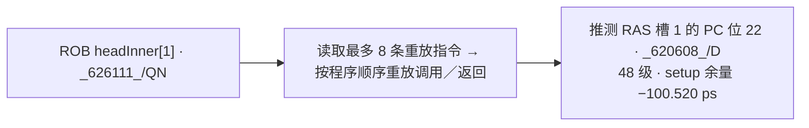

代表终点到达 **2.040881 ns**，要求 **1.940361 ns**。5 个并列最差端点共用前 44 级，其中第 15–44 级的重放控制与写槽选择合计 **1.367 ns**。第 2 级算出的低三位进位因 `replayOffset` 始终按 8 对齐而恒为零，但 `head[1]` 仍经旁支影响 bank 选择，不能将整条路径标为假路径。逐级证据 `.cpu2026-synthesis/production476-rob-ras-path-r01/{prefix,result}.json`。

相对 475 版，原来 6 个最差 ALU1 输入的余量由 **−102.408 ps** 改善至 **−17.266～+1.851 ps**；全局违例 **2636→2003**，PRF 数据 **1075→688**，D$ 控制 **0→10**。当时的全组非退化未通过，完整 FF 对应待审。新增的组合候选数组展开警告已复核，无锁存或新增状态。证据 `.cpu2026-synthesis/axi-alu1-from475-20261120-r02/diagnostic-review.json` 及同目录 `02-lsu-owner-candidate/{completion,group-comparison}.json`。

**目标缺口（固定 476 网表延时）：** 478 MHz 有 **53** 个 RAS 槽 PC 端点超时，最差缺 **8.470 ps**；480 MHz 有 **99** 个：RAS 槽 PC **79**、D$ **17**、PRF 数据 **3**。若只消除 RAS 槽 PC 和栈深的 130 个 2.0 ns 违例，其余不变，约受 ROB→D$ 限制在 **478.95 MHz**。这是条件估算，不是重映射结果；理想时钟、无寄生的 STA 不等于运行时敏化证明或后布局签核。

### 前生产 476：ROB→D$ 地址

- **共用路径：** `headInner[3]` → D$ `way0/bank0/lane0/addr_in[5]`，43 级，余量 **−87.887 ps**。2.0 ns 下 432 个 D$ 地址违例中，424 个共用前 26 级。480 MHz 下的 16 个地址缺口均为位 5、同源且共用前 42 级（最差缺 **4.554 ps**）；另一个 D$ 端点是 `readWayMaskInner[1]`（共用前 36 级，缺 **0.684 ps**）。末级 OAI21 驱动四个宏脚、20 fF，耗时 **179.042 ps**。467 MHz 候选在同一个位 5 脚反而改善 **22.819 ps**，退化集中到了其他脚，不能用修候选位 0 代替修生产路径。
- **稳态布尔复核：** 第 27–29 级引入请求槽 2 的七个 set 位；单独翻转第 29 级可改变第 30 级，但不能改变第 31 级或代表宏地址。独立翻转第 30 级则可影响宏地址。RTL 中新 Store 同 set 取消必有 CPU `valid`，而 `valid` 时旧预取不会获 lookup；真正的同拍 Load 直达地址仍要保留。只翻转 `head[3]` 可改变裸地址，但两组稳态都使能该宏读时不能改变该地址位；要求按 STA 极性逐级翻转，走到第 29 级有解、到第 31 级无解。这不是动态敏化或假路径证明，不改 STA 约束。原路径 `.cpu2026-synthesis/production476-rob-dcache-path-r01/{worst.rpt,route-r02.json}`，布尔结果 `production476-rob-dcache-path-r03/result.json`。478 MHz 优先看 RAS，不恢复旧 D$ 候选。

### 下一步选题：先缩短共享栈深串传

- **双门槛：** 478 MHz 剩余的 53 个 RAS 端点共用前 40 级，槽 0/1/2 分别为 **5/25/23**；第 15–40 级约 **1.220 ns**。但 2.0 ns 下 130 个 RAS 槽 PC／栈深违例中，按所存最差路径统一缩短 **40 ps** 仍无一清零（首个缺 **41.870 ps**）；缩短 60/80 ps 也只跨过 **2/29** 个。其余端点已有 **1873** 个违例。末组版其余端点增至 **2893**，两条一组版增至 **5322**；槽 PC／栈深之外的路径仍须计数。以上为固定路径筛选，不是重映射承诺。
- **单路实验：** 476 版共享段第 19–21 级合计 **227.231 ps**；活跃重放时第 21 级输出反相等价于第 2 路（下标 1）输出深度位 1，侧输入含该路退栈后位 1。独立改写三位输出深度后，槽 1 最差余量改善 **12.300 ps**，但全槽 478 MHz 超时 **53→70**，整核转为 SQ→PRF（**−114.598 ps**）。具名端点复核确认 AXI `wordResponseOutput[66]` 与 `lastBeatValidInner` 是同一网，两版都计时；匿名 FF 全对应未证明，原退出码保留。证据 `.cpu2026-synthesis/ras-scalar-lane-20261121-r01/{selection,result}.json`、`ras-scalar-lane-20261121-r02/audit.json`。
- **SQ→PRF 同脚复查：** 强制从 `sqAddressInner[1][3]` 到 PRF 39/45/47 的 `wd_in[16]`，生产余量 **+68.616/+9.116/+9.119 ps**，三位版均为 **−114.598 ps**；原 ALU0 路径在同三脚反而改善。生产不应跟着三位版去补 SQ；该起点作为新映射的诊断项。证据 `.cpu2026-synthesis/ras-scalar-lane-20261121-r02/sq-prf/result.json`。
- **位 1 对照：** 从同一 476 生产版独立改写位 1，槽 1 改善 **6.547 ps**，最慢转到 `head[0]`→槽 2（**−100.078 ps**），478 MHz 的 RAS 超时 **53→56**。PRF 数据／FF 违例 **688→875／873→1342**；全 FF 身份对应，228 个宏一致。未提频，未采用。证据 `.cpu2026-synthesis/ras-scalar-bit1-20261121-r02/{result.json,01-bit1-depth/group-comparison.json}`。
- **物理行组合预译码：** ROB 选路改传 **2 位动作**而非 **20 位原始指令字段**；RAS 槽 PC 最差余量改善 **34.265 ps**，478 MHz 下 RAS 超时清零，但非 RAS 有 **49** 个超时，2.0 ns 下槽 PC 仍有 **128** 个违例。恢复 `active` 起跳的违例 **0→1384**（其中 **1119** 个是前端 IQ）。证据 `.cpu2026-synthesis/rob-ras-actions-20261121-r03/`。

## 未采用的独立候选

下列候选均从 476 版独立测量：原六答案、周期和完整退休记录不变，228 个 SRAM 实例一致。局部改善不足以覆盖整核退化。

| 候选 | Fmax（MHz） | 面积（μm²） | 2.0 ns 违例端点 | 局部结果与整核瓶颈 |
|---|---:|---:|---:|---|
| ROB 重放直取 `nextTag` | 472.979215 | 33962.59 | 2425 | RAS 槽 PC 违例 128→124；AGU→PRF 成为瓶颈 |
| RAS 有效前缀、写槽并行 | 470.372072 | 34025.00 | 2588 | 3 个栈深位均满足约束，槽 PC 最差余量退化至 −125.426 ps |
| RAS 两条一组 `T[1:4]` | 445.217391 | 33991.50 | 5322 | RAS 槽 PC 违例清零；AGU→PRF 最差余量 −245.271 ps |
| ROB 重放对齐 XOR | 456.531431 | 34067.32 | 2355 | 槽 PC 最差余量 −70.786 ps；四个架构 RAS SRAM 片选退化至 −189.616 ps |
| RAS 末两路写槽前瞻（槽 0–3） | 467.579909 | 34190.28 | 3024 | 槽 PC 最差余量 −100.520→−93.677 ps；D$ 地址成为瓶颈（−138.277 ps） |
| RAS 第 2 路三位输出深度 | 472.760849 | 34014.41 | 3279 | 槽 1 最差余量 −100.520→−88.220 ps；PRF 数据违例 688→1360，SQ→PRF 成为瓶颈 |
| RAS 第 2 路输出深度仅位 1 | 476.057648 | 34041.77 | 2562 | 槽 1 最差余量 −100.520→−93.973 ps；槽 2 限频，整核违例增加 |
| ROB 物理行组合预译码 | 468.221308 | 33993.70 | 3759 | 槽 PC 最差余量 −100.520→−66.255 ps；D$ 地址限频（−135.357 ps） |

- **深度链与重映射：** 前缀并行版写槽路径仍有 **1.030 ns** 的中间深度串传；两条一组版把槽 PC 最差余量改善至 **+64.615 ps**。同一 AGU→PRF 写脚却由 **49→60 级**，余量 **−1.291→−245.271 ps**；两版均不依赖 RAS 寄存器输出，不能归因于新增恢复拍或 ABC 的单一步骤。即使消除该候选所有 AGU 起跳违例，按其余路径延时不变估算，仍至少有 **2303** 个已确认的非 AGU 违例。
- **末两路前瞻：** 固定各自网表延时，478 MHz 下 RAS 槽 PC 超时 **53→29**（候选均在槽 2）。AGU 起跳且最差路径落在 PRF 数据的违例 **516→144**，但全部 PRF 数据违例 **688→1211**；D$ 地址违例 **432→454**，最差为 ROB `head[1]` → D$ `addr_in[0]`。两版均计时 **28192** 个端点，完整 FF 逐一对应待审。收口警告确认为同一 LSU 组合数组展开编号变化，未重跑综合或改写退出记录。证据 `.cpu2026-synthesis/ras-tail-writer-20261120-r02/{result.json,01-tail-writer/group-comparison.json}`、`ras-tail-writer-20261120-r03/audit.json`。不叠加候选。
- **同一 D$ 宏脚复查：** `way0/bank0/lane0/addr_in[0]` 的 `head[1]` 路径由 **+27.714→−138.277 ps**，`head[3]` 由 **+14.215→−128.446 ps**。两版最差路径的到达差 **152.492 ps**，从首次汇入 D$ 请求状态处分段：之前 **+48.297 ps**，D$ 选路至末级输入 **+52.586 ps**，末级门 **+51.609 ps**。末级仍为同型号 OAI21、四个宏脚共 20 fF；两版该脚的组合支撑均不含 RAS 状态。分段按侧输入定界，不是内部节点等价或运行时敏化证明。
- **工作区证据：** `.cpu2026-synthesis/` 下 `rob-replay-nexttag-20261120-r01/`、`ras-prefix-select-20261120-r01/`、`ras-pair-threshold-20261120-r01/`、`rob-replay-aligned-xor-20261120-r01/` 的 `result.json`；补充 `ras-prefix-depth-audit-20261120-r01/segments.json`、`ras-depth-pair-reasoning-20261120-r01/algebra.json`、`ras-pair-agu-displacement-20261120-r01/result.json`、`ras-agu-preservation-20261120-r01/screen.json`。

## 历史生产与时序诊断

### 前生产：ROB 退休行预译码（475.615420 MHz）

面积 **33900.929067 μm²**；较 474 版 **+0.139% / −13.46 μm²**，原六 IPC 不变；较历史 W8/S **+19.194% / +12.634%**。

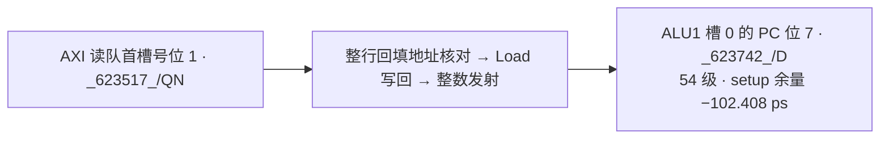

**最差路径复核：** 从 `readHeadOwnerInner[1]` 起跳，时钟到 Q **88.147 ps**。1–9 级从 8 个描述符选出回填地址位 24 的反相（**346.363 ps**，局部穷举 2048 种输入）；10–19 级 D$ 核验回填并选返回来源（**308.011 ps**）；20–33 级 LSU 定位并核验 Load、选写回候选（**565.855 ps**）；34–38 级 ROB 标签核验与写回资格（**159.770 ps**）；39–52 级整数保留站同拍唤醒、排名与发射选路（**526.540 ps**）；53–54 级选载荷与写入／保持（**44.354 ps**）。到达 **2.039040 ns**，要求 **1.936632 ns**；13 个缓冲的 **560.056 ps** 已计入。6 个并列最差端点共用前 52 级，落在 ALU1 槽 0 的 PC、立即数，不是 ALU 运算结果；分段按侧输入与 RTL 解释。

**AXI→LSU 位级锚点：** 组合等价确认第 13 级（**544.291 ps**）为 `!fillBeatInner`，第 15 级（**647.941 ps**）为 `earlyInner`。它经过的是整行回填的地址核对，不是已寄存的两位缺失号 `readHeadTxnInner`；`earlyInner` 允许回填直接响应尚未应答的需求 Load，不必等 D$ 完成最后一拍填充。早回填与逐字返回均不走现有的 hit／buffered 预览，LSU 用实际返回事务号索引 `fifoIndexInner`。前 9 级的 4 个缓冲占 **197.670 ps**，已计入上述延时。

**门级稳态检查：** 固定其余寄存器、宏输出及输入，只翻转 AXI 起点位，ALU1 的 `PC[7]` 输入存在可变的组合赋值；但要求 54 级全部按 STA 所报方向在两组稳态之间翻转则无解。若再要求每级侧输入不变，前 34 级有解，第 35 级 `_357202_/Y` 起无解。这不约束真实时序到达、并发状态变化或可达性，不能据此豁免 STA。

D$ 地址违例 **454→448**，但全局违例 **2143→2636**、TNS **−68.347→−88.509 ns**、PRF 数据违例 **629→1075**。2428 个稳定端点余量下降、无缺失，完整 FF 对应待审；全组非退化未通过。2.0 ns 下，1390 个违例端点的最差路径共用 AXI 代表路径的前 31 级。

**距 480 MHz：** 固定网表延时时，仍超时的 **226** 个端点按各自最差路径分组：AXI→ALU1 **108**（最差缺 **19.075 ps**）、ROB `head[2]`→D$ **90**（**15.323 ps**）、AGU `auxiliaryOutput[2]`→PRF 数据 **27**（**9.909 ps**）、ROB `head[1]`→RAS **1**（**10.202 ps**）。只缩短 AXI 组、其余不变，D$ 地址仍将频率限制在约 **476.5 MHz**。优先看 AXI 回填地址选路／核验和 LSU 写回资格的共享段，同时保留 D$ 地址组为约束。证据 `.cpu2026-synthesis/rob-from474-20261120-r01/01-retire-bank-decode/` 下 `ppa/opt/{design.json,mapped.v,checkpoint-pre-abc.il}`、`endpoints-candidate/{alternative-path-sample.rpt,all-timed-endpoints.tsv,all-violating-worst-paths.json}`、`group-comparison.json`。理想时钟、无寄生 STA，未证明整条路径运行时敏化，不是后布局签核。

**AXI 读队首预存回填地址（未采用）：** **469.509399 MHz / 33894.05 μm²**，较 475 版 **−1.284%**、较 W8/S **+17.664% / +11.188%**，原六 IPC 不变。原 6 个 ALU1 最差位核到相同输入寄存器，余量由 **−102.408 ps** 改为 **−89.663 至 −81.694 ps**，最差起点改为 AXI 写队首槽号位 0。但 I$ `headInner`→`addr_in[0]` 成为全局瓶颈：I$ 地址组最差余量 **+299.543→−129.811 ps**，违例 **0→32**；代表路径的两级大负载缓冲合计 **1.020 ns**。全局违例 **2636→3398**、TNS **−88.509→−144.902 ns**；228 个宏逐实例一致，完整 FF 对应待审。证据 `.cpu2026-synthesis/axi-alu1-from475-20261120-r01/01-axi-read-head-address/{completion,group-comparison}.json` 及 `endpoints-candidate/alternative-path-sample.rpt`。

### 前生产：D$ 按请求槽并行比较命中标签（474.953618 MHz）

面积 **33914.386407 μm²**；较 471 版 **+0.742% / +79.32 μm²**，IPC 不变；较历史 W8/S **+19.028% / +12.477%**。

2.0 ns 下全局违例 **3387→2143**，TNS **−149.943→−68.347 ns**，D$ 地址违例 **450→454**；3011 个稳定端点余量下降、无缺失，完整 FF 对应待审。

**最差路径逐段：** 时钟到 Q **76.434 ps**；1–9 级 ROB 退休选行 **435.945 ps**（含 SQ 槽号最低位）；10–18 级 SQ 核验与退休控制 **407.253 ps**；19–27 级 LSU 请求/地址选择 **360.809 ps**；28–42 级 D$ 请求槽 6 的 set 比较与查找选择 **619.790 ps**；43–48 级归集 128 个 set 的 way 0 有效位并送寄存器 **164.305 ps**。到达 **2064.536 ps**，要求 **1959.330 ps**。段名按映射侧输入及 RTL 解释，不表示每个匿名门都有唯一 RTL 名称。第 28 级切点在第 31 级被屏蔽，但仍可经其他支路影响终点，不能据此豁免整条路径。

**距 480 MHz：** 固定网表延时，将周期放宽至 2.083333 ns 后仍超时的端点，按其最差路径分为三组：

| 起点 → 终点 | 端点数 | 组内最大缺口 |
|---|---:|---:|
| ROB `headInner[0]` → D$ 两个读路掩码位、144 个 SRAM 地址脚 | 146 | 21.873 ps |
| AXI 字返回 `transaction[1]` → ALU1 槽寄存器（37）、Store 地址保留站（1） | 38 | 18.862 ps |
| ROB `headInner[2]` → 推测 RAS 第 1 项的 PC | 23 | 4.868 ps |

144 个 D$ 地址脚与最差路径全部共用前 **32** 级；两个掩码位共用前 **40** 级。优先缩短共用的退休选行与请求仲裁；若 AXI 返回路径延时不变，即使消除两组 ROB 瓶颈，频率仍至多约 **475.69 MHz**。这是同网表估算，非新 STA 或运行时敏化证明。证据 `.cpu2026-synthesis/production474-paths-20261120-r01/result.json`、`.cpu2026-synthesis/night480-20261120-r05/best-path-checked.json`。

### 前生产：Store→Load 同拍广播（471.454880 MHz）

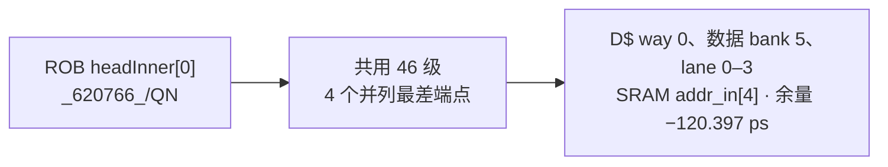

旧 10 个 ALU1 端点的最差余量由 **−114.199 改善至 −80.212 ps**；代表 PC 位 26 为 **−63.340 ps**。旧 ALU0 标签位不再是任何违例端点所保存最差路径的起点。D$ 地址组最差余量从 **−69.190 退化至 −120.397 ps**；整体违例 3499→3387，但 TNS −140.694→−149.943 ns。2480 个稳定计时端点余量下降、无缺失，完整 FF 对应待审，全组非退化未过。228 个宏逐实例一致。证据 `.cpu2026-synthesis/store-notify-direct-473-ppa-20261119-r01/{completion,path-comparison,group-comparison}.json`。

3387 个 setup 违例终点中，普通 FF 1486、PRF 数据 1441、D$ 地址 450、PRF 控制 10。按每个终点的最差路径起点，AXI 写队首槽位 bit 0（1331）、AGU 辅助字段 bit 0（1162）、ROB 队首 bit 0（736）合计占 **95.3%**。前两者覆盖全部 1441 个 PRF 数据违例，后者覆盖全部 450 个 D$ 地址违例。依据同目录 `endpoints-candidate/all-timed-endpoints.tsv` 与 `ppa/opt/checkpoint-pre-abc.il`；不表示运行时触发比例。

**471 版路径逐段复核：** ROB 分 bank 选退休行（1–10 级）→ SQ 核验和实际退休，得 `!postedStoreMaskInner[1]`（11–18）→ LSU Store/Load 让行与请求地址选路（19–27）→ 新 Store 对 D$ 请求槽 6 的同 set 预取取消条件（28–31）→ lookup 候选及选路（32–40）→ bank 地址合并及宏扇出（41–46）。450 个 D$ 地址违例均共用前 31 级；其中 32 个端点缺口 ≥100 ps，都是地址位 4。代表路径到达 **2020.397 ps**，要求 **1900 ps**；9 个缓冲合计 **525.615 ps**，末级单独 **139.964 ps / 20 fF / 4 个宏引脚**。

第 28 级 XOR 的两个布尔余因子在第 29 级仍可不同，但在第 32 级和代表地址脚已证明相同。RTL 原因：新 Store 触发取消必有 CPU `valid`；有需求候选则丢掉预取，无需求候选且 CPU `valid` 则禁止预取进入 lookup。只宜从 lookup 候选分支剥离这条冗余条件；保留完整取消、释放、缺失分配及实际使能，不把整组 STA 标成 false path。逐级延时、侧输入与 SAT 证据 `.cpu2026-synthesis/current-rob-dcache-path-20261119-r01/{summary.json,route.json,sensitize/}`。

**D$ 预取取消与 lookup 并行（未采用）：** 同一 2.0 ns 下 D$ 地址组 **450→0** 个违例，组最差余量 **−120.397→+35.425 ps**，原四个最差宏脚均为 **+105.348 ps**。重新映射后 I$ way 0 的 16 个 `addr_in[2]` 从 **+352.640→−434.307 ps**，末级 NOR2 驱动 80 fF、延时 0.973 ns。整核 **410.750100 MHz / 33901.133187 μm² / IPC 1.109294605**，较生产 **−12.876% / +66.06 μm²**，较历史 W8/S **+2.938% / −2.728%**。总违例 **3387→3355**，TNS **−149.943→−156.576 ns**；3886 个稳定端点余量下降、无缺失，完整 FF 对应待审，228 个宏逐实例一致。恢复后的 ABC 输入与中断前逐字节一致。证据 `.cpu2026-synthesis/dcache-lookup-cancel-resume-20261119-r02/{abc-input,completion,closeout}.json`。

**I$ 退化复核：** 两版均从 I$ `headInner[0]` 起跳，映射前四位地址逻辑同构，映射后逐位 SAT 核对等价；被查地址逻辑无 D$ 状态输入。整核 ABC 重新映射后，候选的回填确认网同时驱动 16 个宏 WE 和 `addr_in[2]` 的选路（约 81 fF、495 ps）；生产地址支路不经过该重载 WE 网。地址脚自身负载仍为 80 fF，但末级 OAI21→NOR2，延时 **637→973 ps**。优先试 D$ 等价改写和独立 I$ 按物理行并行匹配回填，需整核逐脚复测，不用改名、改网表或降低负载冒充收敛。证据 `.cpu2026-synthesis/icache-map-drift-20261120-r01/{result.json,base-sta/pin.rpt}`。

**夜间前三项（独立，未采用）：** D$ 前移预取禁止／I$ 物理槽匹配／D$ 分开选赢家分别 **465.243 / 466.515 / 470.156 MHz**，面积 **33836.75 / 33813.46 / 34017.03 μm²**，原六 IPC 不变，228 个宏逐实例一致。最佳项 D$ 地址违例 **450→56**，I$ 地址 WNS **−32.064 ps**，全局 **−126.654 ps** 改由 D$ `readIndexInner[0]`→PRF 数据限制（该起点覆盖 2186 个违例端点的最差路径）；较生产 **−0.275%**，较 W8/S **+17.826% / +11.341%**。证据 `.cpu2026-synthesis/night480-20261120-r02/`。

**D$ 按缺失槽并行核对写应答／读回填（未采用）：** **470.156107 MHz / 34042.70 μm² / IPC 1.109294605**；较生产 **−0.275%**，较 W8/S **+17.826% / +11.341%**。I$ 地址 WNS **+24.488 ps**，D$ 地址违例 **450→364**；瓶颈转到 AGU `auxiliaryOutput[2]`→PRF 数据（全局 **−126.828 ps**）。证据 `.cpu2026-synthesis/night480-20261120-r03/05-dcache-same-edge-ack-rows/`。

**夜间第 4、6 项：** 后续采用的 D$ 按槽并行比较版，I$ 地址 WNS **+769.978 ps**。独立的 LSU 返回身份前移为 **419.156774 MHz / 34063.26 μm²**，IPC 不变，较 W8/S **+5.045% / −0.737%**，瓶颈 I$ 地址 **−385.281 ps**，未采用。证据 `.cpu2026-synthesis/night480-20261120-r04/`。

**夜间收尾：** 独立预选 D$ 读 way 有效位为 **462.511292 MHz / 33913.80 μm²**（较生产 **−1.897%**，较 W8/S **+15.910% / +9.530%**），IPC 不变，最差退到 D$ `addr_in[5]`（**−161.276 ps**），未采用。最佳 474.954 MHz 版若固定现有延时，在 480 MHz 仍约有 **207** 个 setup 端点不满足（其中 D$ 地址 144），最大缺口 **21.873 ps**；不是只修一个寄存器。该版第 28 级比较在第 31 级已被屏蔽，但对 `readWayMaskInner[0]` 的人工切点对照仍可经其他支路产生差异。证据 `.cpu2026-synthesis/night480-20261120-r05/{completion,best-path-checked}.json`。

### 前生产：AXI 读、写队首同拍保存（472.979215 MHz）

前版随 AXI 读、写队首切换同拍保存各自的 2 位缺失号。相对只保存读队首的实测频率不变，面积减少 **116.35 μm²**；较历史 W8/S **+18.533% / +12.009%**。

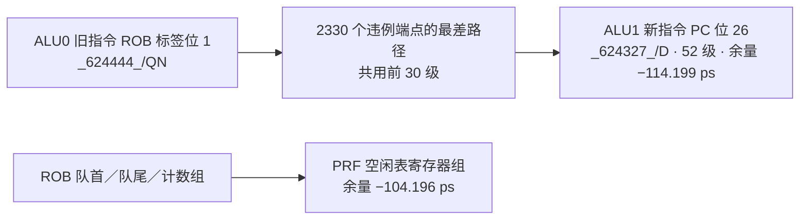

逐端点最差路径不再以 AXI 为起点。全局有 10 个并列最差端点，共用前 49 级，落在 ALU1 的 PC／立即数／右操作数。Fmax 报告值不变，但 WNS **−114.055→−114.199 ps**，违例端点 **3033→3499**，TNS **−127.285→−140.694 ns**。D$ 地址组 WNS **−113.663→−69.190 ps**；其他组退化另计，2564 个稳定端点余量下降、无缺失，全组非退化未通过。原六完整退休不变，按用户授权采用。证据 `.cpu2026-synthesis/write-head-txn-473-resume-20261119-r03/{completion,closeout}.json`。

**位级复核：** 这是一条旧结果核对到新指令装槽的同拍控制路径，不是两路 ALU 串联运算。第 8 级由 ALU0 的标签低 4 位从 16 行中定位 ROB 条目，输出所选行有效且标签位 0、3 匹配的部分资格；第 11 级有 Store 数据保留站侧输入，第 19 级有 LSU Store 提交状态侧输入，第 40 级有整数保留站侧输入。最后一级接各自的保持反馈。代表数据到达 **2.050830 ns**，要求 **1.936632 ns**。位级及局部函数证据 `.cpu2026-synthesis/write-head-current-path-20261119-r01/{result,side-inputs}.json`；不等同于整条路径已实证运行时可敏化。

**代表路径上的具名节点（含反相等价）：** ALU0 `robTag[1]` → 第 9 级 ALU0 写回有效 → 第 11 级 Store 数据保留站行 0 的源 1 就绪 → 第 15 级 LSU Store 槽号的一位 → 第 17 级槽号 6 的译码 → 第 31 级 Load 写回候选的 `robTag[4]` → 第 39 级 `loadResultEligibleInner` → 第 40 级整数保留站行 0 的源 1 就绪 → 第 43 级行 3 的排名低位 → 第 48 级 ALU1 `pushHereInner` → 第 52 级 ALU1 槽 `PC[26]` 的写入／保持。第 19–30 级是从 Store 事件核对到 Load 结果选择的组合逻辑，未给每个匿名门指定 RTL 名称。此前网表与其映射前快照的组合等价证据：同目录 `anchors.json`、`middle.json`。

### 前生产：AXI 只保存读队首事务号（472.979215 MHz）

相比 472.106962 MHz 版提频 **+0.185%**，面积 **34093.283007 μm²**；下图与随后三组路径分析均为此前网表。

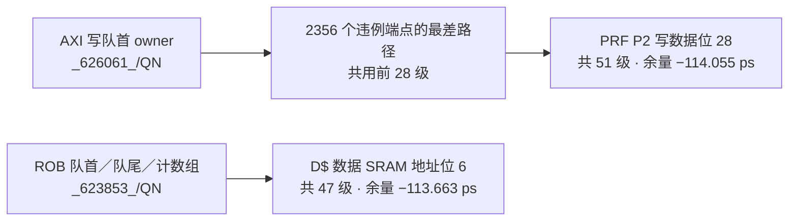

两条路径只差 **0.392 ps**。对照前版相同的 10 个 ALU 操作数端点，各自最差路径 **57→56 级**，共同前缀 **55→52 级**；右操作数位 23 的余量 **−117.540→−99.581 ps**。新瓶颈在写队首一侧。

2.0 ns 下总违例 **3968→3033**，TNS **−156.602→−127.285 ns**；D$ 地址组违例 **336→454**。6 个端点组退化，3135 个稳定端点余量下降、无缺失，完整 FF 对应待审。按提频采用，全组非退化未通过。实测与逐端点证据：`.cpu2026-synthesis/head-txn-472-20261119-r02/{completion.json,group-comparison.json,closure-analysis/}`。后续时序分析应同时看图中两条路径。

### 前生产距 500 MHz 的三组路径

对 28190 个计时端点按各自最差 setup 路径归类。3033 个违例端点来自下表三处；三条代表路径两两不共用物理引脚。这是端点统计，不排除同一端点还有次差路径。

| 起点 → 代表终点 | 最差余量 | 违例端点 | TNS | 共享段与限制 |
|---|---:|---:|---:|---|
| AXI 写队首 → PRF P2 写数据位 28 | −114.055 ps | 2356 | −85.351 ns | 全部共用前 28 级；第 5 级为 8:1 选择，第 9 级汇入 D$ 状态，第 23 级直接接入 LSU 状态。终点包括 1421 个 PRF 数据、27 个 PRF 控制、908 个 FF。 |
| ROB 队首／队尾／计数组 → D$ 数据 SRAM 地址位 6 | −113.663 ps | 629 | −39.384 ns | 第 8 级为 16:1 行状态选择。454 个 D$ 地址违例全部共用前 33 级；其余 175 个为 FF。缺口 ≥100 ps 的端点中，此组占 144/171。 |
| I$ 队列状态 → I$ 数据 SRAM 地址位 3 | −86.565 ps | 48 | −2.550 ns | 全部共用前 19 级，抵达 `u_axi_fetch.consumeInner`。代表路径仅 22 级；第 19、22 级负载约 84、80 fF，两级合计约 1.01 ns，末级驱动 16 个宏地址引脚。 |

若其他路径延时保持不变，只修 AXI 一组仍受 ROB 路径约 **473.1 MHz** 限制；前两组都修掉，I$ 仍将频率限制在约 **479.3 MHz**。这是固定网表的条件上界。优先核查写应答身份与 D$ 回填资格，以及 ROB 提交资格、LSU 访存地址与 D$ 分组地址选择；I$ 单独检查回填握手和宏地址负载。门级选路真值与侧输入已核对，未证明整条路径运行时可敏化。复核证据：`.cpu2026-synthesis/head-txn-500-paths-20261119-r01/{analysis,checked}.json`。

**AXI 写队首的前 28 级（同一拍）：** 从发射 Q 到 `_356835_/Y` 共 **1000.878 ps**。1–8 级（290.362 ps）从 8 个描述符选同一槽的两位并译码；9–14 级（225.138 ps）汇入 D$ 写应答／回填条件，第 13 级的两个侧输入分别比较写侧选出位与寄存的两位读事务号。15–22 级（249.959 ps）在 D$ 返回来源间选事务号，形成 LSU 的 3 位返回槽选择；23–28 级（235.419 ps）用该选择从 8 个传输槽读出 3 位 Load 队列索引，再用索引选行状态。第 28 级只合并其中 4 行，不是最终写回许可。8 个缓冲的延时已含在上述分段中（316.659 ps）。RTL 见 `rv32_dcache.sv:508–529,588–593`、`rv32_lsu.sv:709–723`；局部真值证据同目录 `prefix28.json`。

例如一条 Load 等在 `LQ[4]`：发请求时 LSU 留下 `fifoIndexInner[7]=4`，D$ 的请求槽 5 保存返回号 7；发生缺失后，缺失表第 2 项记下 `missesInner[2].owner=5`。若脏行写回描述符放在 AXI 槽 6，里面保存的是缺失号 2。返回时先用 `6→2` 查这笔写回能否放行缺失 2 的读回填，再沿 `2→5→7→4` 找回原 Load。这些数字是不同表的下标，示例不代表实测事件，也不表示每次查表都串行执行。

### 前生产：D$ Store 队首预选（472.106962 MHz）

获准写入的 Store 必为最老需求行。SRAM 端口提前从该行选地址、数据和字节掩码，由原仲裁决定是否写入。较前生产 455.313473 MHz **+3.688%**，较历史 W8/S **+18.315% / +11.803%**；面积增加 21.59 μm²，IPC 不变，228 个宏逐实例一致。

D$ 地址组最差余量 **−195.359→−38.838 ps**，违例端点 442→336。新前五条最差路径均从 `rv32_axi_data` 的队首 owner 寄存器组到 `rv32_alu_unit` 的槽寄存器组，各经过 57 级组合单元。下图取 STA 第一条；实线是同一拍内的路径，虚线是该门的侧输入依赖。图中数值为从发射时钟沿起算的累计到达时间。

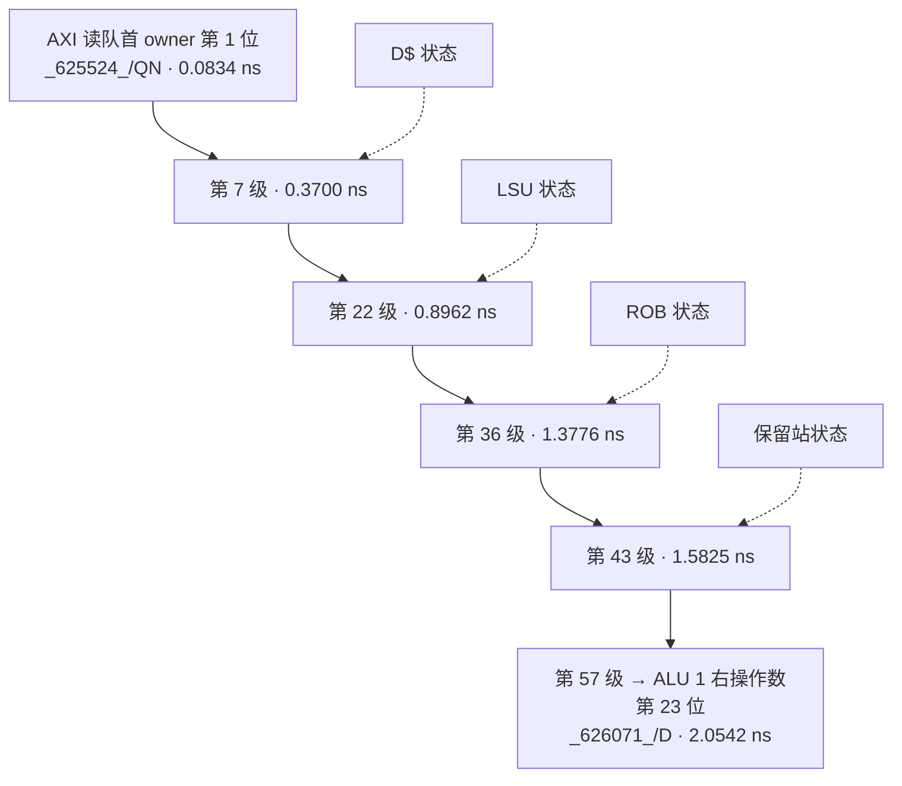

2.0 ns 下该端点要求 **1.9366 ns** 到达，实际 **2.0542 ns**，精确余量 **−117.540 ps**。全局 TNS 从 −142.746 ns 降到 −156.602 ns，违例端点 3231→3968，3971 个稳定端点余量下降、无缺失，全组非退化未过。工作区 STA 原文 `ras4-store-head-20261119-r03/ppa/opt/timing.rpt`，原始路径图及侧输入对应见 `ras4-store-head-production-20261119-r01/{critical-path.svg,diagram-data.json}`（均在 `.cpu2026-synthesis/` 下）。

**共享段复核：** 逐端点最差路径中，2659/3968 个违例从 `readHeadOwnerInner[1]` 出发，共用前 15 级，占全局 TNS 的 80.54%；其中 2611 个共用前 22 级。前 8 级包含两次串联选择：先从 8 个 AXI 描述符选出两个位，再据此选择 4 个 D$ 状态位之一。10 个并列最差端点共用前 55 级，最后两级才分别写 ALU 1 的不同操作数位。15 级缓冲合计 589.8 ps，最慢单级为 60.8 ps。另一个起点的最差路径为 ROB→RAS（−92.949 ps），比全局仅宽 24.591 ps。优先试读队首元数据提前准备；局部真值表及 ALU 结果函数等价核对不代表整条路径运行时可敏化。证据 `.cpu2026-synthesis/store-head-critical-audit-20261119-r01/{conclusions,cascade,timing-analysis}.json`。

### 深度 8 基线上的历史试验

以下试验相对前生产深度 8 的 **395.366795 MHz / 34245.769979 μm²**（`build/synth/opt/report.json`）。

450 MHz 对应周期 2.2222 ns。生产基线的前五条最差路径均到 RAS SRAM 片选，共用节点负载 43.39 fF。用 squash 选读写模式、由每槽提交掩码决定实际写入后，候选为 **400.939702 MHz / 34339.796399 μm² / IPC 1.110948571**，较同口径基线 +1.410%，较历史 W8 +0.480%、S −5.051%。原六周期不变，232 宏。2.0 ns 下八个片选的最差余量从 −528.715 ps 到 +198.274 ps；全局最差余量 −493.975 ps，新前五条均为 I$ 内部 FF→FF（31 级，逻辑位身份待审）。全局 TNS 从 −184.340 ns 降至 −793.733 ns，违例端点 3110→4969；2994 个稳定端点余量下降，missing 0，全组非退化未通过。证据 `.cpu2026-synthesis/f450-ras-readmode-resume-r03/{completion,group-comparison,critical-origin-review}.json`。

11 月 19 日采用的 RAS 深度 4 较深度 8 同口径提频 **15.162%**；较历史 W8、S 分别 **+14.106%、+7.826%**。关键端点转至 D$ 数据宏地址。2.0 ns 下 WNS −195.359 ps、TNS −142.746152 ns，28188 个计时端点中 3231 个有 setup 违例。全组非退化未通过，全域 2160 个稳定端点余量下降、136 个不再对应，完整 FF 对应待审；232→228 宏，仅少预期的 4 个 RAS 宏。证据 `morning-fmax-20261119-r02/ras4/{result,group-comparison}.json`。

为何只改深度便能提频：两份 `ppa/opt/design.json`（基线为 `build/synth/opt/design.json`）显示，RAS 共享写使能仍由同型号 NAND4 驱动，但负载引脚从 17 个降至 9 个，其中 SRAM 写使能从 8 个减为 4 个。完整端点表中 RAS 片选最差余量从 −528.715 ps 升至 +94.581 ps，而 D$ 地址组仅从 −205.362 ps 升至 −195.359 ps，成为新瓶颈。深度参数也切换了重放实现，不能将收益全部归给负载。六项中只有 towers 增加 52 拍。

BTB64 为 **402.515723 MHz / 36031.353419 μm² / IPC 1.112267128**，较 2.0 ns 生产基线 +1.808%，较历史 W8 +0.875%、S −4.678%。面积超限 31.35 μm²，不进入合格排名。证据 `morning-fmax-20261119-r02/btb64/result.json`。

独立的 RAS 写使能候选 `firstpush` 基于前生产深度 8。524288 组控制组合、真实模块 1160 次检查及两个满栈故障反例通过；该深度 8 候选实测 **412.404350 MHz / 34306.379039 μm² / IPC 1.110948571**，未采用。证据 `morning-ras-firstpush-20261119-r01/`。

## 历史测量对照（2.5 ns 映射）

| 版本 | 估计 Fmax（MHz） | 面积（μm²） | 原六几何 IPC |
|---|---:|---:|---:|
| S：SQ 扫描前移 | 422.268041 | 33905.822699 | 1.074546042 |
| W8：八槽恢复 | 399.025816 | 34632.577379 | 1.110948571 |
| 八路 RAS 组合重放 | **427.892400** | **34370.020739** | **1.110948571** |

八路 RAS 版较 W8 提频 **7.234%**，较 S 提频 **1.332%**；含 22417 个 FF 和 232 个 SRAM 宏。原六周期和退休记录见[验证](assessment.md#验证范围与测试入口)。

## 400 MHz 与 500 MHz

| 八路 RAS 版，同一网表 | 最差 setup 余量 | 总负余量 | setup 违例端点 |
|---|---:|---:|---:|
| 400 MHz / 2.5 ns | +163.482 ps | 0 ns | 0 |
| 500 MHz / 2.0 ns | −336.518 ps | −852.336353 ns | 4819 |

- 两次 STA 均覆盖 28459 个计时端点。400 MHz 下，W8 的 3 个 ROB 头到 RAS 栈的 setup 违例消除，但完整分组非退化未通过：D$ 地址、其他 SRAM 控制／数据和输出组余量下降。全域 2600 个稳定端点余量下降，输入域另有 92 个（不叠加计数）；两域均无缺失，完整 FF 对应待审。
- 最差路径从 AXI 读队首 owner 位 2 到乘法保留站槽 0 的源操作数 1 位 30。500 MHz 下，2990 个违例端点的最差路径共享前 28 级；后续提频应先核查 AXI 读队首到 PRF／保留站的共用选择逻辑。
- 结果基于理想时钟、无互连寄生的 STA，不代表运行时敏化、完整 RAS 写使能电气验证或后布局签核。

### 同一 RTL，默认 `make synth` 为什么是 395 MHz？

`build/synth/opt/report.json` 的 45 个综合输入 SHA 与当时深度 8 的生产指针一致，`filelist.f` 也一致。区别在**映射目标**：427.892400 MHz 对应 2.5 ns 目标生成的网表；默认 `make synth` 用 2.0 ns，`scripts/synth.py` 也把它传给 ABC。此次 `build/synth/opt/synth.log` 记录了 `&nf -D 2000`、`upsize -D 2000`、`dnsize -D 2000`。在同一 2.0 ns STA 目标下，旧网表最差余量 −336.518 ps，新网表 −528.715 ps；新关键端点为 RAS SRAM `lane_0/ce_in`。新映射为 **395.366795 MHz / 34245.769979 μm²**（较 W8 −0.917%、较 S −6.371%）。旧实验原始网表已不在当前工作区，不能逐门归因。

## 证据

- 400 MHz 与端点对照：`.cpu2026-synthesis/w8-ras-depth-rails-ppa-20261118-r01/{completion,full-group-and-stable-comparison}.json`。
- 500 MHz 核查：`.cpu2026-synthesis/w8-ras-depth-rails-sta-2ns-20261118-r01/{completion,path-review}.json`。
- [旧版时序记录](https://github.com/CPU-2026/RISC-V-CPU-2026/blob/0c9ba970ac4ed233e52c1bbe2e06c29f0ffb8c24/docs/%E9%A2%91%E7%8E%87%E5%88%86%E6%9E%90.md)。

[历史 25 项结构方案的整核对照](https://github.com/CPU-2026/RISC-V-CPU-2026/blob/0c9ba970ac4ed233e52c1bbe2e06c29f0ffb8c24/docs/%E9%A2%91%E7%8E%87%E5%88%86%E6%9E%90.md#ppa25)。
