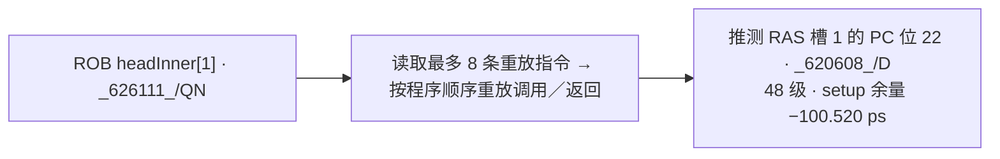
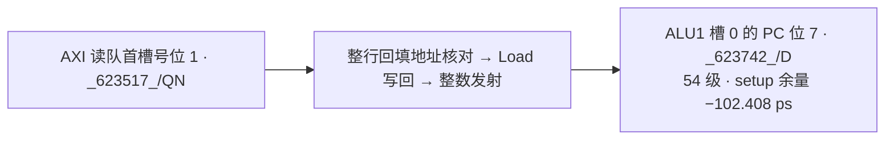
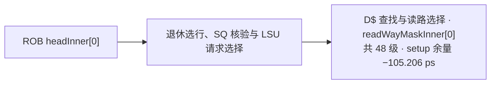
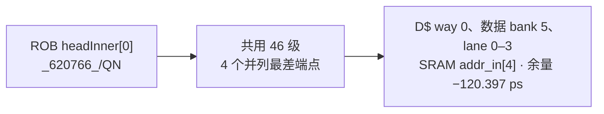
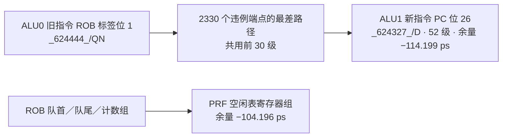
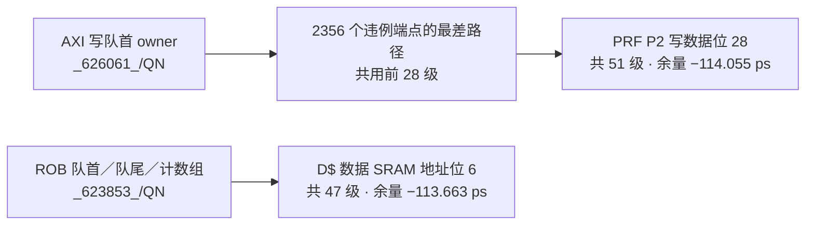
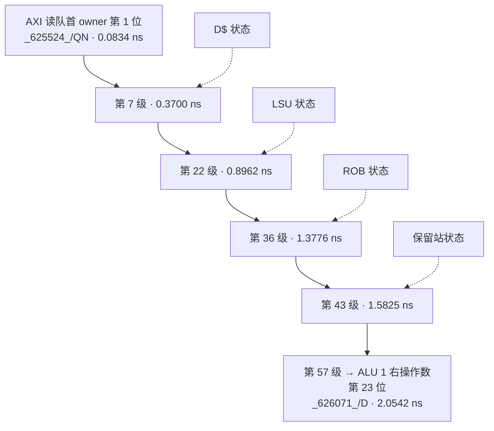

# 整核时序分析

## 当前生产

LSU 按返回槽预备 Load 候选版：**476.057648 MHz／34068.905247 μm²／原六几何 IPC 1.109294605**。映射与 STA 均用 **2.0 ns**；28192 个计时端点中 **2003** 个 setup 违例，WNS **−100.520 ps**、TNS **−61.050 ns**，228 个 SRAM 实例。较 475 版 Fmax **+0.093%**、面积 **+167.98 μm²**；较 455 MHz 提交基线（`0f5a1d7`）**+4.556%**，较历史 W8／S **+19.305%／+12.738%**。[采用顺序](history.md#本次采用顺序) · [验证口径](assessment.md)。

### 当前生产：关键路径示意图

代表终点到达 **2.040881 ns**，要求 **1.940361 ns**。5 个并列最差端点共用前 44 级，其中第 15–44 级的重放控制与写槽选择合计 **1.367 ns**。第 2 级算出的低三位进位因 `replayOffset` 始终按 8 对齐而恒为零，但 `head[1]` 仍经旁支影响 bank 选择，不能将整条路径标为假路径。逐级证据 `.cpu2026-synthesis/production476-rob-ras-path-r01/{prefix,result}.json`。

相对 475 版，原来 6 个最差 ALU1 输入的余量由 **−102.408 ps** 改善至 **−17.266～+1.851 ps**；全局违例 **2636→2003**，PRF 数据 **1075→688**，D$ 控制 **0→10**。当时的全组非退化未通过，完整 FF 对应待审。新增的组合候选数组展开警告已复核，无锁存或新增状态。证据 `.cpu2026-synthesis/axi-alu1-from475-20261120-r02/diagnostic-review.json` 及同目录 `02-lsu-owner-candidate/{completion,group-comparison}.json`。

**目标缺口（固定当前网表延时）：** 478 MHz 有 **53** 个 RAS 槽 PC 端点超时，最差缺 **8.470 ps**；480 MHz 有 **99** 个：RAS 槽 PC **79**、D$ **17**、PRF 数据 **3**。若只消除 RAS 槽 PC 和栈深的 130 个 2.0 ns 违例，其余不变，约受 ROB→D$ 限制在 **478.95 MHz**。这是条件估算，不是重映射结果；理想时钟、无寄生的 STA 不等于运行时敏化证明或后布局签核。

## 未采用的独立候选

下列四项均从 476 版独立测量：原六答案、周期和完整退休记录不变，228 个 SRAM 实例一致。局部改善不足以覆盖整核退化。

| 候选 | Fmax（MHz） | 面积（μm²） | 2.0 ns 违例端点 | 局部结果与整核瓶颈 |
|---|---:|---:|---:|---|
| ROB 重放直取 `nextTag` | 472.979215 | 33962.59 | 2425 | RAS 槽 PC 违例 128→124；AGU→PRF 成为瓶颈 |
| RAS 有效前缀、写槽并行 | 470.372072 | 34025.00 | 2588 | 3 个栈深位均满足约束，槽 PC 最差余量退化至 −125.426 ps |
| RAS 两条一组 `T[1:4]` | 445.217391 | 33991.50 | 5322 | RAS 槽 PC 违例清零；AGU→PRF 最差余量 −245.271 ps |
| ROB 重放对齐 XOR | 456.531431 | 34067.32 | 2355 | 槽 PC 最差余量 −70.786 ps；四个架构 RAS SRAM 片选退化至 −189.616 ps |

- **深度链与重映射：** 前缀并行版写槽路径仍有 **1.030 ns** 的中间深度串传；两条一组版把槽 PC 最差余量改善至 **+64.615 ps**。同一 AGU→PRF 写脚却由 **49→60 级**，余量 **−1.291→−245.271 ps**；两版均不依赖 RAS 寄存器输出，不能归因于新增恢复拍或 ABC 的单一步骤。即使消除该候选所有 AGU 起跳违例，按其余路径延时不变估算，仍至少有 **2303** 个已确认的非 AGU 违例。
- **工作区证据：** `.cpu2026-synthesis/` 下 `rob-replay-nexttag-20261120-r01/`、`ras-prefix-select-20261120-r01/`、`ras-pair-threshold-20261120-r01/`、`rob-replay-aligned-xor-20261120-r01/` 的 `result.json`；补充 `ras-prefix-depth-audit-20261120-r01/segments.json`、`ras-depth-pair-reasoning-20261120-r01/algebra.json`、`ras-pair-agu-displacement-20261120-r01/result.json`、`ras-agu-preservation-20261120-r01/screen.json`。

## 历史生产与时序诊断

### 前生产：ROB 退休行预译码（475.615420 MHz）

面积 **33900.929067 μm²**；较 474 版 **+0.139% / −13.46 μm²**，原六 IPC 不变；较历史 W8/S **+19.194% / +12.634%**。

**最差路径复核：** 从 `readHeadOwnerInner[1]` 起跳，时钟到 Q **88.147 ps**。1–9 级从 8 个描述符选出回填地址位 24 的反相（**346.363 ps**，局部穷举 2048 种输入）；10–19 级 D$ 核验回填并选返回来源（**308.011 ps**）；20–33 级 LSU 定位并核验 Load、选写回候选（**565.855 ps**）；34–38 级 ROB 标签核验与写回资格（**159.770 ps**）；39–52 级整数保留站同拍唤醒、排名与发射选路（**526.540 ps**）；53–54 级选载荷与写入／保持（**44.354 ps**）。到达 **2.039040 ns**，要求 **1.936632 ns**；13 个缓冲的 **560.056 ps** 已计入。6 个并列最差端点共用前 52 级，落在 ALU1 槽 0 的 PC、立即数，不是 ALU 运算结果；分段按侧输入与 RTL 解释。

**AXI→LSU 位级锚点：** 组合等价确认第 13 级（**544.291 ps**）为 `!fillBeatInner`，第 15 级（**647.941 ps**）为 `earlyInner`。它经过的是整行回填的地址核对，不是已寄存的两位缺失号 `readHeadTxnInner`；`earlyInner` 允许回填直接响应尚未应答的需求 Load，不必等 D$ 完成最后一拍填充。早回填与逐字返回均不走现有的 hit／buffered 预览，LSU 用实际返回事务号索引 `fifoIndexInner`。前 9 级的 4 个缓冲占 **197.670 ps**，已计入上述延时。

**门级稳态检查：** 固定其余寄存器、宏输出及输入，只翻转 AXI 起点位，ALU1 的 `PC[7]` 输入存在可变的组合赋值；但要求 54 级全部按 STA 所报方向在两组稳态之间翻转则无解。若再要求每级侧输入不变，前 34 级有解，第 35 级 `_357202_/Y` 起无解。这不约束真实时序到达、并发状态变化或可达性，不能据此豁免 STA。

D$ 地址违例 **454→448**，但全局违例 **2143→2636**、TNS **−68.347→−88.509 ns**、PRF 数据违例 **629→1075**。2428 个稳定端点余量下降、无缺失，完整 FF 对应待审；全组非退化未通过。2.0 ns 下，1390 个违例端点的最差路径共用 AXI 代表路径的前 31 级。

**距 480 MHz：** 固定网表延时时，仍超时的 **226** 个端点按各自最差路径分组：AXI→ALU1 **108**（最差缺 **19.075 ps**）、ROB `head[2]`→D$ **90**（**15.323 ps**）、AGU `auxiliaryOutput[2]`→PRF 数据 **27**（**9.909 ps**）、ROB `head[1]`→RAS **1**（**10.202 ps**）。只缩短 AXI 组、其余不变，D$ 地址仍将频率限制在约 **476.5 MHz**。优先看 AXI 回填地址选路／核验和 LSU 写回资格的共享段，同时保留 D$ 地址组为约束。证据 `.cpu2026-synthesis/rob-from474-20261120-r01/01-retire-bank-decode/` 下 `ppa/opt/{design.json,mapped.v,checkpoint-pre-abc.il}`、`endpoints-candidate/{alternative-path-sample.rpt,all-timed-endpoints.tsv,all-violating-worst-paths.json}`、`group-comparison.json`。理想时钟、无寄生 STA，未证明整条路径运行时敏化，不是后布局签核。

**AXI 读队首预存回填地址（未采用）：** **469.509399 MHz / 33894.05 μm²**，较 475 版 **−1.284%**、较 W8/S **+17.664% / +11.188%**，原六 IPC 不变。原 6 个 ALU1 最差位核到相同输入寄存器，余量由 **−102.408 ps** 改为 **−89.663 至 −81.694 ps**，最差起点改为 AXI 写队首槽号位 0。但 I$ `headInner`→`addr_in[0]` 成为全局瓶颈：I$ 地址组最差余量 **+299.543→−129.811 ps**，违例 **0→32**；代表路径的两级大负载缓冲合计 **1.020 ns**。全局违例 **2636→3398**、TNS **−88.509→−144.902 ns**；228 个宏逐实例一致，完整 FF 对应待审。证据 `.cpu2026-synthesis/axi-alu1-from475-20261120-r01/01-axi-read-head-address/{completion,group-comparison}.json` 及 `endpoints-candidate/alternative-path-sample.rpt`。

### 前生产：D$ 按请求槽并行比较命中标签（474.953618 MHz）

面积 **33914.386407 μm²**；较 471 版 **+0.742% / +79.32 μm²**，IPC 不变；较历史 W8/S **+19.028% / +12.477%**。

2.0 ns 下全局违例 **3387→2143**，TNS **−149.943→−68.347 ns**，D$ 地址违例 **450→454**；3011 个稳定端点余量下降、无缺失，完整 FF 对应待审。

**最差路径逐段：** 时钟到 Q **76.434 ps**；1–9 级 ROB 退休选行 **435.945 ps**（含 SQ 槽号最低位）；10–18 级 SQ 核验与退休控制 **407.253 ps**；19–27 级 LSU 请求/地址选择 **360.809 ps**；28–42 级 D$ 请求槽 6 的 set 比较与查找选择 **619.790 ps**；43–48 级归集 128 个 set 的 way 0 有效位并送寄存器 **164.305 ps**。到达 **2064.536 ps**，要求 **1959.330 ps**。段名按映射侧输入及 RTL 解释，不表示每个匿名门都有唯一 RTL 名称。第 28 级切点在第 31 级被屏蔽，但仍可经其他支路影响终点，不能据此豁免整条路径。

**距 480 MHz：** 固定网表延时，将周期放宽至 2.083333 ns 后仍超时的端点，按其最差路径分为三组：

| 起点 → 终点 | 端点数 | 组内最大缺口 |
|---|---:|---:|
| ROB `headInner[0]` → D$ 两个读路掩码位、144 个 SRAM 地址脚 | 146 | 21.873 ps |
| AXI 字返回 `transaction[1]` → ALU1 槽寄存器（37）、Store 地址保留站（1） | 38 | 18.862 ps |
| ROB `headInner[2]` → 推测 RAS 第 1 项的 PC | 23 | 4.868 ps |

144 个 D$ 地址脚与最差路径全部共用前 **32** 级；两个掩码位共用前 **40** 级。优先缩短共用的退休选行与请求仲裁；若 AXI 返回路径延时不变，即使消除两组 ROB 瓶颈，频率仍至多约 **475.69 MHz**。这是同网表估算，非新 STA 或运行时敏化证明。证据 `.cpu2026-synthesis/production474-paths-20261120-r01/result.json`、`.cpu2026-synthesis/night480-20261120-r05/best-path-checked.json`。

### 前生产：Store→Load 同拍广播（471.454880 MHz）

旧 10 个 ALU1 端点的最差余量由 **−114.199 改善至 −80.212 ps**；代表 PC 位 26 为 **−63.340 ps**。旧 ALU0 标签位不再是任何违例端点所保存最差路径的起点。D$ 地址组最差余量从 **−69.190 退化至 −120.397 ps**；整体违例 3499→3387，但 TNS −140.694→−149.943 ns。2480 个稳定计时端点余量下降、无缺失，完整 FF 对应待审，全组非退化未过。228 个宏逐实例一致。证据 `.cpu2026-synthesis/store-notify-direct-473-ppa-20261119-r01/{completion,path-comparison,group-comparison}.json`。

3387 个 setup 违例终点中，普通 FF 1486、PRF 数据 1441、D$ 地址 450、PRF 控制 10。按每个终点的最差路径起点，AXI 写队首槽位 bit 0（1331）、AGU 辅助字段 bit 0（1162）、ROB 队首 bit 0（736）合计占 **95.3%**。前两者覆盖全部 1441 个 PRF 数据违例，后者覆盖全部 450 个 D$ 地址违例。依据同目录 `endpoints-candidate/all-timed-endpoints.tsv` 与 `ppa/opt/checkpoint-pre-abc.il`；不表示运行时触发比例。

**471 版路径逐段复核：** ROB 分 bank 选退休行（1–10 级）→ SQ 核验和实际退休，得 `!postedStoreMaskInner[1]`（11–18）→ LSU Store/Load 让行与请求地址选路（19–27）→ 新 Store 对 D$ 请求槽 6 的同 set 预取取消条件（28–31）→ lookup 候选及选路（32–40）→ bank 地址合并及宏扇出（41–46）。450 个 D$ 地址违例均共用前 31 级；其中 32 个端点缺口 ≥100 ps，都是地址位 4。代表路径到达 **2020.397 ps**，要求 **1900 ps**；9 个缓冲合计 **525.615 ps**，末级单独 **139.964 ps / 20 fF / 4 个宏引脚**。

第 28 级 XOR 的两个布尔余因子在第 29 级仍可不同，但在第 32 级和代表地址脚已证明相同。RTL 原因：新 Store 触发取消必有 CPU `valid`；有需求候选则丢掉预取，无需求候选且 CPU `valid` 则禁止预取进入 lookup。只宜从 lookup 候选分支剥离这条冗余条件；保留完整取消、释放、缺失分配及实际使能，不把整组 STA 标成 false path。逐级延时、侧输入与 SAT 证据 `.cpu2026-synthesis/current-rob-dcache-path-20261119-r01/{summary.json,route.json,sensitize/}`。

**D$ 预取取消与 lookup 并行（未采用）：** 同一 2.0 ns 下 D$ 地址组 **450→0** 个违例，组最差余量 **−120.397→+35.425 ps**，原四个最差宏脚均为 **+105.348 ps**。重新映射后 I$ way 0 的 16 个 `addr_in[2]` 从 **+352.640→−434.307 ps**，末级 NOR2 驱动 80 fF、延时 0.973 ns。整核 **410.750100 MHz / 33901.133187 μm² / IPC 1.109294605**，较生产 **−12.876% / +66.06 μm²**，较历史 W8/S **+2.938% / −2.728%**。总违例 **3387→3355**，TNS **−149.943→−156.576 ns**；3886 个稳定端点余量下降、无缺失，完整 FF 对应待审，228 个宏逐实例一致。恢复后的 ABC 输入与中断前逐字节一致。证据 `.cpu2026-synthesis/dcache-lookup-cancel-resume-20261119-r02/{abc-input,completion,closeout}.json`。

**I$ 退化复核：** 两版均从 I$ `headInner[0]` 起跳，映射前四位地址逻辑同构，映射后逐位 SAT 核对等价；被查地址逻辑无 D$ 状态输入。整核 ABC 重新映射后，候选的回填确认网同时驱动 16 个宏 WE 和 `addr_in[2]` 的选路（约 81 fF、495 ps）；生产地址支路不经过该重载 WE 网。地址脚自身负载仍为 80 fF，但末级 OAI21→NOR2，延时 **637→973 ps**。优先试 D$ 等价改写和独立 I$ 按物理行并行匹配回填，需整核逐脚复测，不用改名、改网表或降低负载冒充收敛。证据 `.cpu2026-synthesis/icache-map-drift-20261120-r01/{result.json,base-sta/pin.rpt}`。

**夜间前三项（独立，未采用）：** D$ 前移预取禁止／I$ 物理槽匹配／D$ 分开选赢家分别 **465.243 / 466.515 / 470.156 MHz**，面积 **33836.75 / 33813.46 / 34017.03 μm²**，原六 IPC 不变，228 个宏逐实例一致。最佳项 D$ 地址违例 **450→56**，I$ 地址 WNS **−32.064 ps**，全局 **−126.654 ps** 改由 D$ `readIndexInner[0]`→PRF 数据限制（该起点覆盖 2186 个违例端点的最差路径）；较生产 **−0.275%**，较 W8/S **+17.826% / +11.341%**。证据 `.cpu2026-synthesis/night480-20261120-r02/`。

**D$ 按缺失槽并行核对写应答／读回填（未采用）：** **470.156107 MHz / 34042.70 μm² / IPC 1.109294605**；较生产 **−0.275%**，较 W8/S **+17.826% / +11.341%**。I$ 地址 WNS **+24.488 ps**，D$ 地址违例 **450→364**；瓶颈转到 AGU `auxiliaryOutput[2]`→PRF 数据（全局 **−126.828 ps**）。证据 `.cpu2026-synthesis/night480-20261120-r03/05-dcache-same-edge-ack-rows/`。

**夜间第 4、6 项：** 后续采用的 D$ 按槽并行比较版，I$ 地址 WNS **+769.978 ps**。独立的 LSU 返回身份前移为 **419.156774 MHz / 34063.26 μm²**，IPC 不变，较 W8/S **+5.045% / −0.737%**，瓶颈 I$ 地址 **−385.281 ps**，未采用。证据 `.cpu2026-synthesis/night480-20261120-r04/`。

**夜间收尾：** 独立预选 D$ 读 way 有效位为 **462.511292 MHz / 33913.80 μm²**（较生产 **−1.897%**，较 W8/S **+15.910% / +9.530%**），IPC 不变，最差退到 D$ `addr_in[5]`（**−161.276 ps**），未采用。最佳 474.954 MHz 版若固定现有延时，在 480 MHz 仍约有 **207** 个 setup 端点不满足（其中 D$ 地址 144），最大缺口 **21.873 ps**；不是只修一个寄存器。该版第 28 级比较在第 31 级已被屏蔽，但对 `readWayMaskInner[0]` 的人工切点对照仍可经其他支路产生差异。证据 `.cpu2026-synthesis/night480-20261120-r05/{completion,best-path-checked}.json`。

### 前生产：AXI 读、写队首同拍保存（472.979215 MHz）

前版随 AXI 读、写队首切换同拍保存各自的 2 位缺失号。相对只保存读队首的实测频率不变，面积减少 **116.35 μm²**；较历史 W8/S **+18.533% / +12.009%**。

逐端点最差路径不再以 AXI 为起点。全局有 10 个并列最差端点，共用前 49 级，落在 ALU1 的 PC／立即数／右操作数。Fmax 报告值不变，但 WNS **−114.055→−114.199 ps**，违例端点 **3033→3499**，TNS **−127.285→−140.694 ns**。D$ 地址组 WNS **−113.663→−69.190 ps**；其他组退化另计，2564 个稳定端点余量下降、无缺失，全组非退化未通过。原六完整退休不变，按用户授权采用。证据 `.cpu2026-synthesis/write-head-txn-473-resume-20261119-r03/{completion,closeout}.json`。

**位级复核：** 这是一条旧结果核对到新指令装槽的同拍控制路径，不是两路 ALU 串联运算。第 8 级由 ALU0 的标签低 4 位从 16 行中定位 ROB 条目，输出所选行有效且标签位 0、3 匹配的部分资格；第 11 级有 Store 数据保留站侧输入，第 19 级有 LSU Store 提交状态侧输入，第 40 级有整数保留站侧输入。最后一级接各自的保持反馈。代表数据到达 **2.050830 ns**，要求 **1.936632 ns**。位级及局部函数证据 `.cpu2026-synthesis/write-head-current-path-20261119-r01/{result,side-inputs}.json`；不等同于整条路径已实证运行时可敏化。

**代表路径上的具名节点（含反相等价）：** ALU0 `robTag[1]` → 第 9 级 ALU0 写回有效 → 第 11 级 Store 数据保留站行 0 的源 1 就绪 → 第 15 级 LSU Store 槽号的一位 → 第 17 级槽号 6 的译码 → 第 31 级 Load 写回候选的 `robTag[4]` → 第 39 级 `loadResultEligibleInner` → 第 40 级整数保留站行 0 的源 1 就绪 → 第 43 级行 3 的排名低位 → 第 48 级 ALU1 `pushHereInner` → 第 52 级 ALU1 槽 `PC[26]` 的写入／保持。第 19–30 级是从 Store 事件核对到 Load 结果选择的组合逻辑，未给每个匿名门指定 RTL 名称。此前网表与其映射前快照的组合等价证据：同目录 `anchors.json`、`middle.json`。

### 前生产：AXI 只保存读队首事务号（472.979215 MHz）

相比 472.106962 MHz 版提频 **+0.185%**，面积 **34093.283007 μm²**；下图与随后三组路径分析均为此前网表。

两条路径只差 **0.392 ps**。对照前版相同的 10 个 ALU 操作数端点，各自最差路径 **57→56 级**，共同前缀 **55→52 级**；右操作数位 23 的余量 **−117.540→−99.581 ps**。新瓶颈在写队首一侧。

2.0 ns 下总违例 **3968→3033**，TNS **−156.602→−127.285 ns**；D$ 地址组违例 **336→454**。6 个端点组退化，3135 个稳定端点余量下降、无缺失，完整 FF 对应待审。按提频采用，全组非退化未通过。实测与逐端点证据：`.cpu2026-synthesis/head-txn-472-20261119-r02/{completion.json,group-comparison.json,closure-analysis/}`。后续时序分析应同时看图中两条路径。

### 前生产距 500 MHz 的三组路径

对 28190 个计时端点按各自最差 setup 路径归类。3033 个违例端点来自下表三处；三条代表路径两两不共用物理引脚。这是端点统计，不排除同一端点还有次差路径。

| 起点 → 代表终点 | 最差余量 | 违例端点 | TNS | 共享段与限制 |
|---|---:|---:|---:|---|
| AXI 写队首 → PRF P2 写数据位 28 | −114.055 ps | 2356 | −85.351 ns | 全部共用前 28 级；第 5 级为 8:1 选择，第 9 级汇入 D$ 状态，第 23 级直接接入 LSU 状态。终点包括 1421 个 PRF 数据、27 个 PRF 控制、908 个 FF。 |
| ROB 队首／队尾／计数组 → D$ 数据 SRAM 地址位 6 | −113.663 ps | 629 | −39.384 ns | 第 8 级为 16:1 行状态选择。454 个 D$ 地址违例全部共用前 33 级；其余 175 个为 FF。缺口 ≥100 ps 的端点中，此组占 144/171。 |
| I$ 队列状态 → I$ 数据 SRAM 地址位 3 | −86.565 ps | 48 | −2.550 ns | 全部共用前 19 级，抵达 `u_axi_fetch.consumeInner`。代表路径仅 22 级；第 19、22 级负载约 84、80 fF，两级合计约 1.01 ns，末级驱动 16 个宏地址引脚。 |

若其他路径延时保持不变，只修 AXI 一组仍受 ROB 路径约 **473.1 MHz** 限制；前两组都修掉，I$ 仍将频率限制在约 **479.3 MHz**。这是固定网表的条件上界。优先核查写应答身份与 D$ 回填资格，以及 ROB 提交资格、LSU 访存地址与 D$ 分组地址选择；I$ 单独检查回填握手和宏地址负载。门级选路真值与侧输入已核对，未证明整条路径运行时可敏化。复核证据：`.cpu2026-synthesis/head-txn-500-paths-20261119-r01/{analysis,checked}.json`。

**AXI 写队首的前 28 级（同一拍）：** 从发射 Q 到 `_356835_/Y` 共 **1000.878 ps**。1–8 级（290.362 ps）从 8 个描述符选同一槽的两位并译码；9–14 级（225.138 ps）汇入 D$ 写应答／回填条件，第 13 级的两个侧输入分别比较写侧选出位与寄存的两位读事务号。15–22 级（249.959 ps）在 D$ 返回来源间选事务号，形成 LSU 的 3 位返回槽选择；23–28 级（235.419 ps）用该选择从 8 个传输槽读出 3 位 Load 队列索引，再用索引选行状态。第 28 级只合并其中 4 行，不是最终写回许可。8 个缓冲的延时已含在上述分段中（316.659 ps）。RTL 见 `rv32_dcache.sv:508–529,588–593`、`rv32_lsu.sv:709–723`；局部真值证据同目录 `prefix28.json`。

例如一条 Load 等在 `LQ[4]`：发请求时 LSU 留下 `fifoIndexInner[7]=4`，D$ 的请求槽 5 保存返回号 7；发生缺失后，缺失表第 2 项记下 `missesInner[2].owner=5`。若脏行写回描述符放在 AXI 槽 6，里面保存的是缺失号 2。返回时先用 `6→2` 查这笔写回能否放行缺失 2 的读回填，再沿 `2→5→7→4` 找回原 Load。这些数字是不同表的下标，示例不代表实测事件，也不表示每次查表都串行执行。

### 前生产：D$ Store 队首预选（472.106962 MHz）

获准写入的 Store 必为最老需求行。SRAM 端口提前从该行选地址、数据和字节掩码，由原仲裁决定是否写入。较前生产 455.313473 MHz **+3.688%**，较历史 W8/S **+18.315% / +11.803%**；面积增加 21.59 μm²，IPC 不变，228 个宏逐实例一致。

D$ 地址组最差余量 **−195.359→−38.838 ps**，违例端点 442→336。新前五条最差路径均从 `rv32_axi_data` 的队首 owner 寄存器组到 `rv32_alu_unit` 的槽寄存器组，各经过 57 级组合单元。下图取 STA 第一条；实线是同一拍内的路径，虚线是该门的侧输入依赖。图中数值为从发射时钟沿起算的累计到达时间。

2.0 ns 下该端点要求 **1.9366 ns** 到达，实际 **2.0542 ns**，精确余量 **−117.540 ps**。全局 TNS 从 −142.746 ns 降到 −156.602 ns，违例端点 3231→3968，3971 个稳定端点余量下降、无缺失，全组非退化未过。工作区 STA 原文 `ras4-store-head-20261119-r03/ppa/opt/timing.rpt`，原始路径图及侧输入对应见 `ras4-store-head-production-20261119-r01/{critical-path.svg,diagram-data.json}`（均在 `.cpu2026-synthesis/` 下）。

**共享段复核：** 逐端点最差路径中，2659/3968 个违例从 `readHeadOwnerInner[1]` 出发，共用前 15 级，占全局 TNS 的 80.54%；其中 2611 个共用前 22 级。前 8 级包含两次串联选择：先从 8 个 AXI 描述符选出两个位，再据此选择 4 个 D$ 状态位之一。10 个并列最差端点共用前 55 级，最后两级才分别写 ALU 1 的不同操作数位。15 级缓冲合计 589.8 ps，最慢单级为 60.8 ps。另一个起点的最差路径为 ROB→RAS（−92.949 ps），比全局仅宽 24.591 ps。优先试读队首元数据提前准备；局部真值表及 ALU 结果函数等价核对不代表整条路径运行时可敏化。证据 `.cpu2026-synthesis/store-head-critical-audit-20261119-r01/{conclusions,cascade,timing-analysis}.json`。

### 深度 8 基线上的历史试验

以下试验相对前生产深度 8 的 **395.366795 MHz / 34245.769979 μm²**（`build/synth/opt/report.json`）。

450 MHz 对应周期 2.2222 ns。生产基线的前五条最差路径均到 RAS SRAM 片选，共用节点负载 43.39 fF。用 squash 选读写模式、由每槽提交掩码决定实际写入后，候选为 **400.939702 MHz / 34339.796399 μm² / IPC 1.110948571**，较同口径基线 +1.410%，较历史 W8 +0.480%、S −5.051%。原六周期不变，232 宏。2.0 ns 下八个片选的最差余量从 −528.715 ps 到 +198.274 ps；全局最差余量 −493.975 ps，新前五条均为 I$ 内部 FF→FF（31 级，逻辑位身份待审）。全局 TNS 从 −184.340 ns 降至 −793.733 ns，违例端点 3110→4969；2994 个稳定端点余量下降，missing 0，全组非退化未通过。证据 `.cpu2026-synthesis/f450-ras-readmode-resume-r03/{completion,group-comparison,critical-origin-review}.json`。

11 月 19 日采用的 RAS 深度 4 较深度 8 同口径提频 **15.162%**；较历史 W8、S 分别 **+14.106%、+7.826%**。关键端点转至 D$ 数据宏地址。2.0 ns 下 WNS −195.359 ps、TNS −142.746152 ns，28188 个计时端点中 3231 个有 setup 违例。全组非退化未通过，全域 2160 个稳定端点余量下降、136 个不再对应，完整 FF 对应待审；232→228 宏，仅少预期的 4 个 RAS 宏。证据 `morning-fmax-20261119-r02/ras4/{result,group-comparison}.json`。

为何只改深度便能提频：两份 `ppa/opt/design.json`（基线为 `build/synth/opt/design.json`）显示，RAS 共享写使能仍由同型号 NAND4 驱动，但负载引脚从 17 个降至 9 个，其中 SRAM 写使能从 8 个减为 4 个。完整端点表中 RAS 片选最差余量从 −528.715 ps 升至 +94.581 ps，而 D$ 地址组仅从 −205.362 ps 升至 −195.359 ps，成为新瓶颈。深度参数也切换了重放实现，不能将收益全部归给负载。六项中只有 towers 增加 52 拍。

BTB64 为 **402.515723 MHz / 36031.353419 μm² / IPC 1.112267128**，较 2.0 ns 生产基线 +1.808%，较历史 W8 +0.875%、S −4.678%。面积超限 31.35 μm²，不进入合格排名。证据 `morning-fmax-20261119-r02/btb64/result.json`。

独立的 RAS 写使能候选 `firstpush` 基于前生产深度 8。524288 组控制组合、真实模块 1160 次检查及两个满栈故障反例通过；该深度 8 候选实测 **412.404350 MHz / 34306.379039 μm² / IPC 1.110948571**，未采用。证据 `morning-ras-firstpush-20261119-r01/`。

## 历史测量对照（2.5 ns 映射）

| 版本 | 估计 Fmax（MHz） | 面积（μm²） | 原六几何 IPC |
|---|---:|---:|---:|
| S：SQ 扫描前移 | 422.268041 | 33905.822699 | 1.074546042 |
| W8：八槽恢复 | 399.025816 | 34632.577379 | 1.110948571 |
| 八路 RAS 组合重放 | **427.892400** | **34370.020739** | **1.110948571** |

八路 RAS 版较 W8 提频 **7.234%**，较 S 提频 **1.332%**；含 22417 个 FF 和 232 个 SRAM 宏。原六周期和退休记录见[验证](assessment.md#验证范围与测试入口)。

## 400 MHz 与 500 MHz

| 八路 RAS 版，同一网表 | 最差 setup 余量 | 总负余量 | setup 违例端点 |
|---|---:|---:|---:|
| 400 MHz / 2.5 ns | +163.482 ps | 0 ns | 0 |
| 500 MHz / 2.0 ns | −336.518 ps | −852.336353 ns | 4819 |

- 两次 STA 均覆盖 28459 个计时端点。400 MHz 下，W8 的 3 个 ROB 头到 RAS 栈的 setup 违例消除，但完整分组非退化未通过：D$ 地址、其他 SRAM 控制／数据和输出组余量下降。全域 2600 个稳定端点余量下降，输入域另有 92 个（不叠加计数）；两域均无缺失，完整 FF 对应待审。
- 最差路径从 AXI 读队首 owner 位 2 到乘法保留站槽 0 的源操作数 1 位 30。500 MHz 下，2990 个违例端点的最差路径共享前 28 级；后续提频应先核查 AXI 读队首到 PRF／保留站的共用选择逻辑。
- 结果基于理想时钟、无互连寄生的 STA，不代表运行时敏化、完整 RAS 写使能电气验证或后布局签核。

### 同一 RTL，默认 `make synth` 为什么是 395 MHz？

`build/synth/opt/report.json` 的 45 个综合输入 SHA 与当时深度 8 的生产指针一致，`filelist.f` 也一致。区别在**映射目标**：427.892400 MHz 对应 2.5 ns 目标生成的网表；默认 `make synth` 用 2.0 ns，`scripts/synth.py` 也把它传给 ABC。此次 `build/synth/opt/synth.log` 记录了 `&nf -D 2000`、`upsize -D 2000`、`dnsize -D 2000`。在同一 2.0 ns STA 目标下，旧网表最差余量 −336.518 ps，新网表 −528.715 ps；新关键端点为 RAS SRAM `lane_0/ce_in`。新映射为 **395.366795 MHz / 34245.769979 μm²**（较 W8 −0.917%、较 S −6.371%）。旧实验原始网表已不在当前工作区，不能逐门归因。

## 证据

- 400 MHz 与端点对照：`.cpu2026-synthesis/w8-ras-depth-rails-ppa-20261118-r01/{completion,full-group-and-stable-comparison}.json`。
- 500 MHz 核查：`.cpu2026-synthesis/w8-ras-depth-rails-sta-2ns-20261118-r01/{completion,path-review}.json`。
- [旧版时序记录](https://github.com/CPU-2026/RISC-V-CPU-2026/blob/0c9ba970ac4ed233e52c1bbe2e06c29f0ffb8c24/docs/%E9%A2%91%E7%8E%87%E5%88%86%E6%9E%90.md)。

[历史 25 项结构方案的整核对照](https://github.com/CPU-2026/RISC-V-CPU-2026/blob/0c9ba970ac4ed233e52c1bbe2e06c29f0ffb8c24/docs/%E9%A2%91%E7%8E%87%E5%88%86%E6%9E%90.md#ppa25)。
